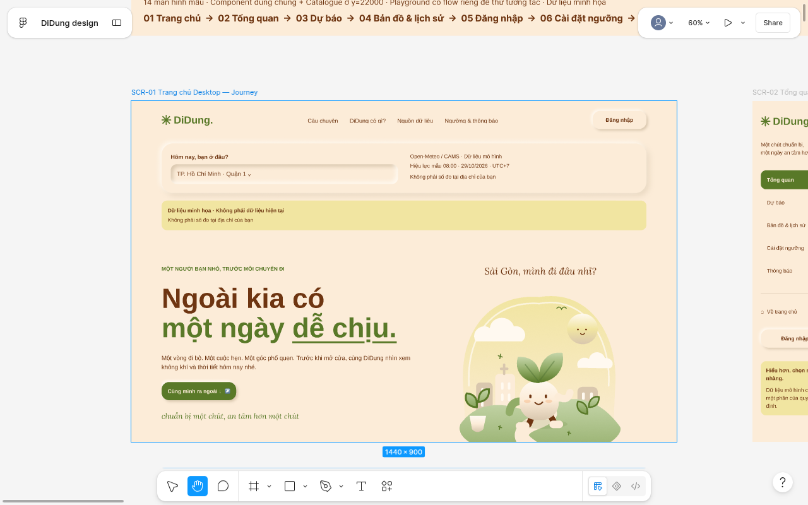
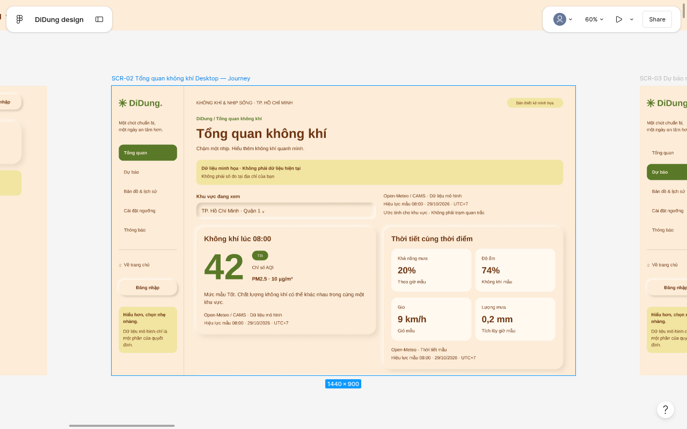
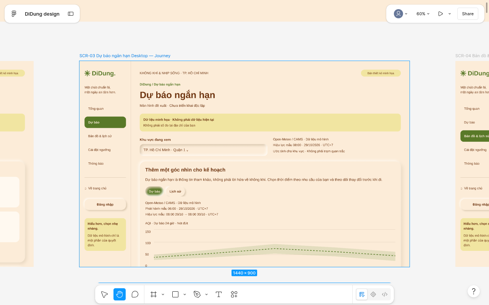
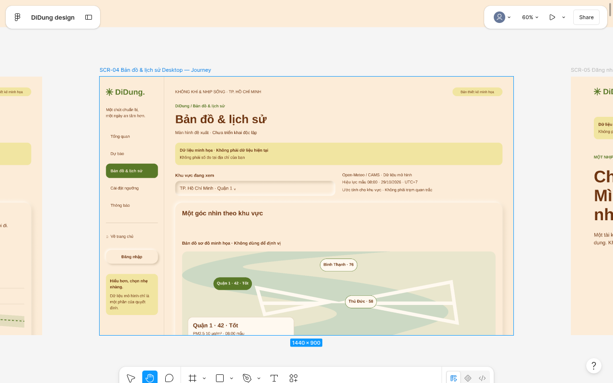
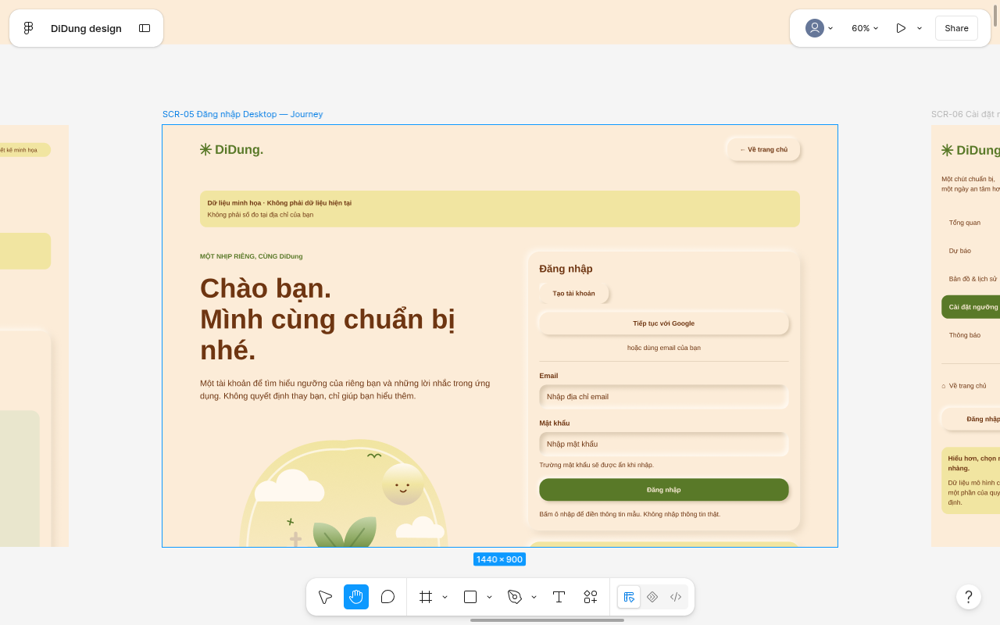
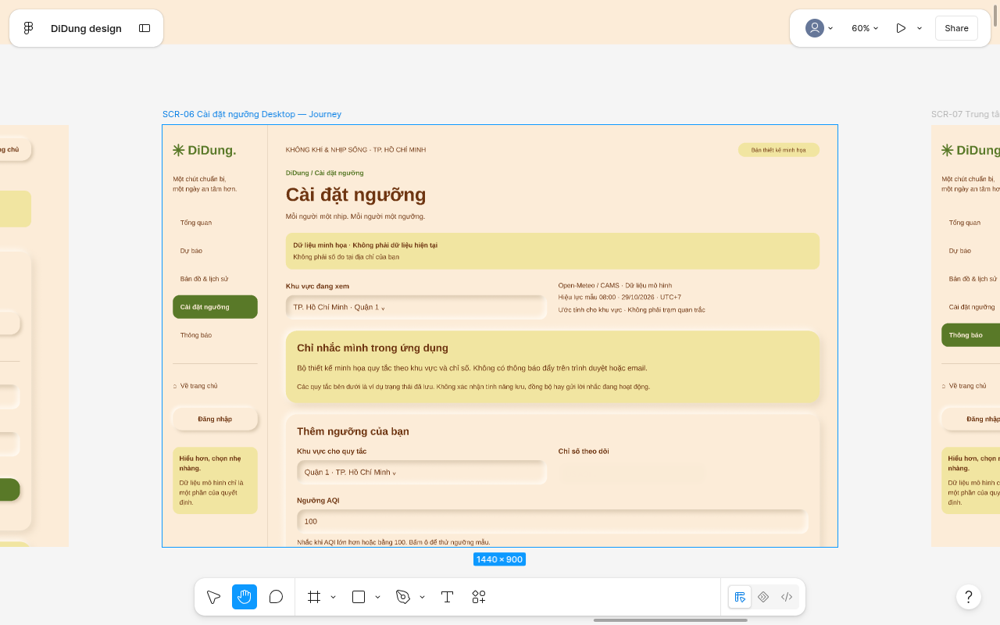
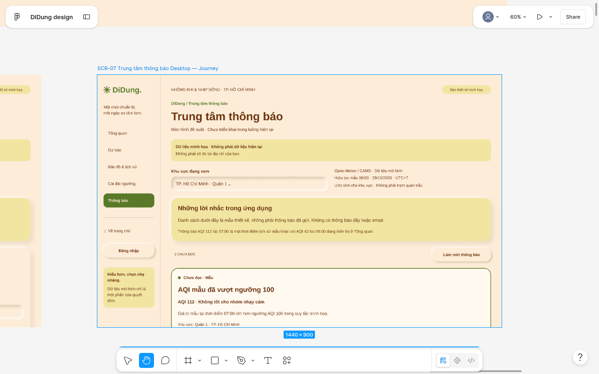

# Figma screen evidence — 16 November 2026

Captured read-only from the existing Interactive Prototype page. These are Figma design screenshots with editor chrome, not screenshots of implemented app screens, not a new design, and not proof of human approval. Content says illustration/model data, not current values. Do not infer feature implementation from these images. Screens were selected from the sidebar; URLs below were read from the browser. PNGs are viewport captures at the automatic fit zoom, not original-resolution exports.

## SCR-01

SCR-01 Trang chủ Desktop

Design: https://www.figma.com/design/Ev67pGKl766yRwq4R7nu7G/DiDung-design?node-id=24-32090

## SCR-02

SCR-02 Tổng quan không khí Desktop

Design: https://www.figma.com/design/Ev67pGKl766yRwq4R7nu7G/DiDung-design?node-id=24-31664

## SCR-03

SCR-03 Dự báo ngắn hạn Desktop

Design: https://www.figma.com/design/Ev67pGKl766yRwq4R7nu7G/DiDung-design?node-id=24-31378

## SCR-04

SCR-04 Bản đồ & lịch sử Desktop

Design: https://www.figma.com/design/Ev67pGKl766yRwq4R7nu7G/DiDung-design?node-id=24-31108

## SCR-05

SCR-05 Đăng nhập Desktop

Design: https://www.figma.com/design/Ev67pGKl766yRwq4R7nu7G/DiDung-design?node-id=24-30889

## SCR-06

SCR-06 Cài đặt ngưỡng Desktop

Design: https://www.figma.com/design/Ev67pGKl766yRwq4R7nu7G/DiDung-design?node-id=24-30726

## SCR-07

SCR-07 Trung tâm thông báo Desktop

Design: https://www.figma.com/design/Ev67pGKl766yRwq4R7nu7G/DiDung-design?node-id=24-30513

