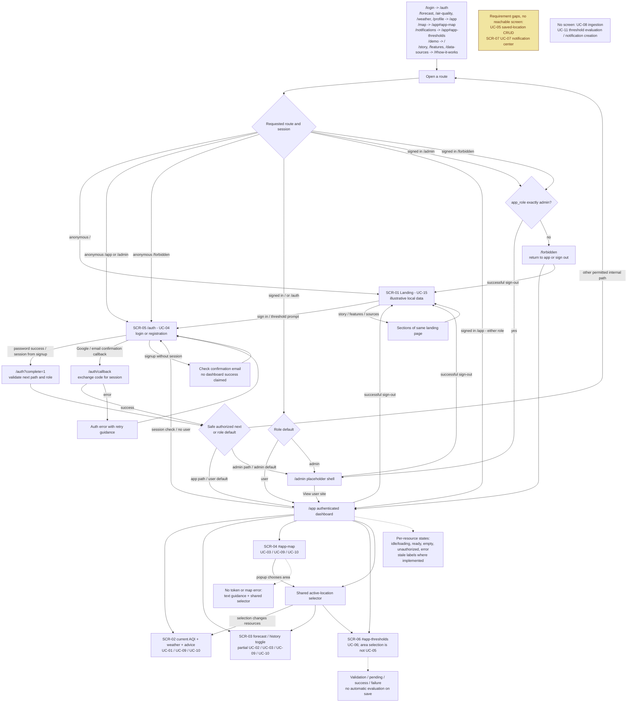
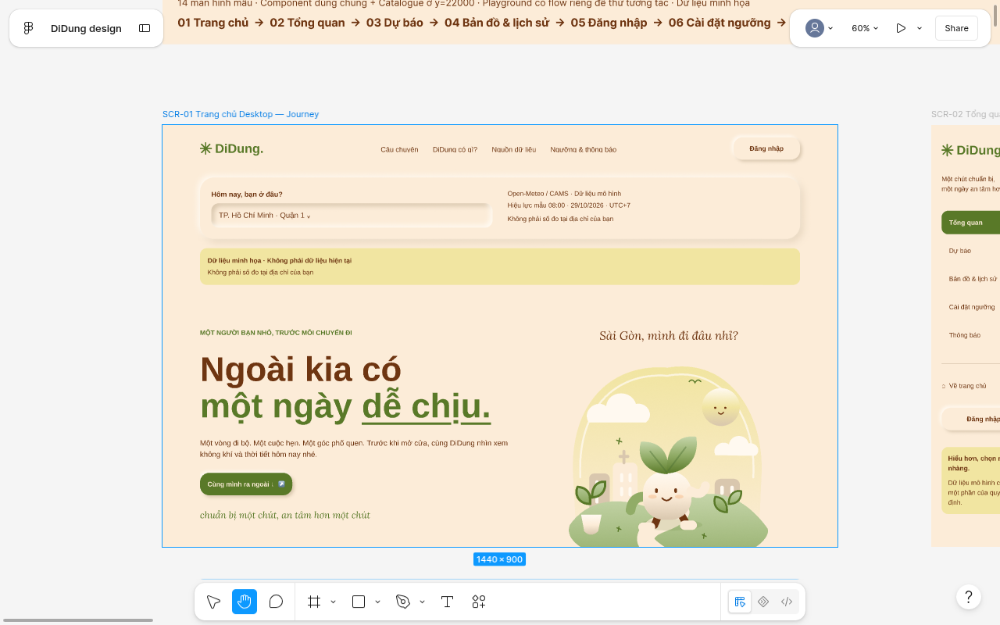
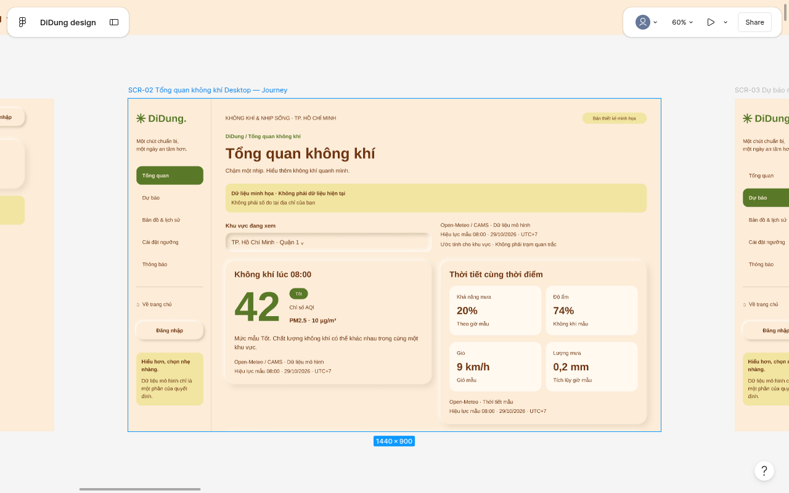
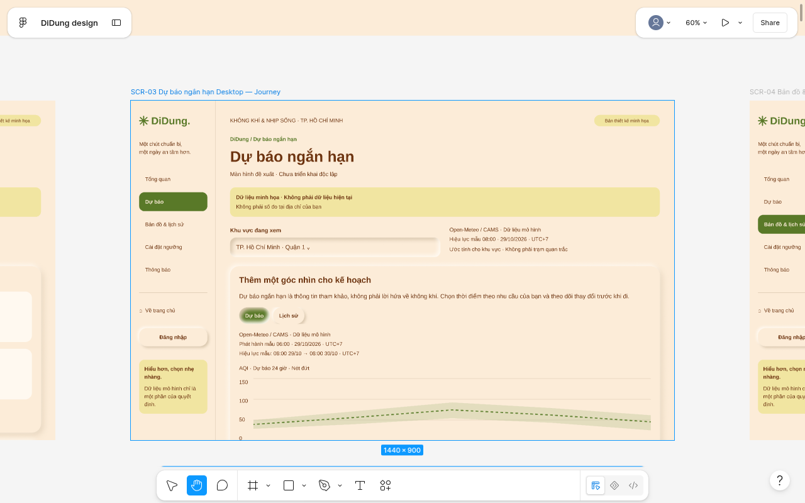
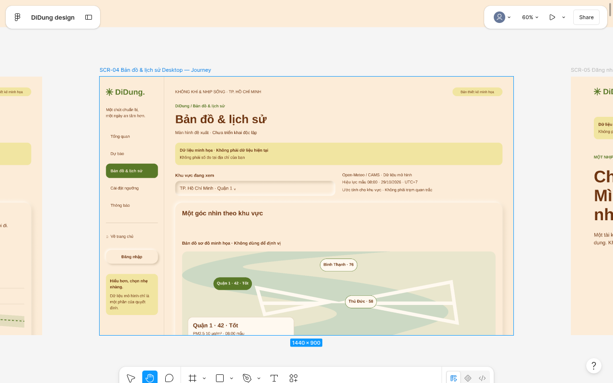
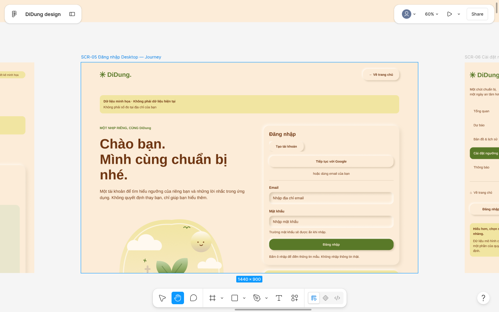
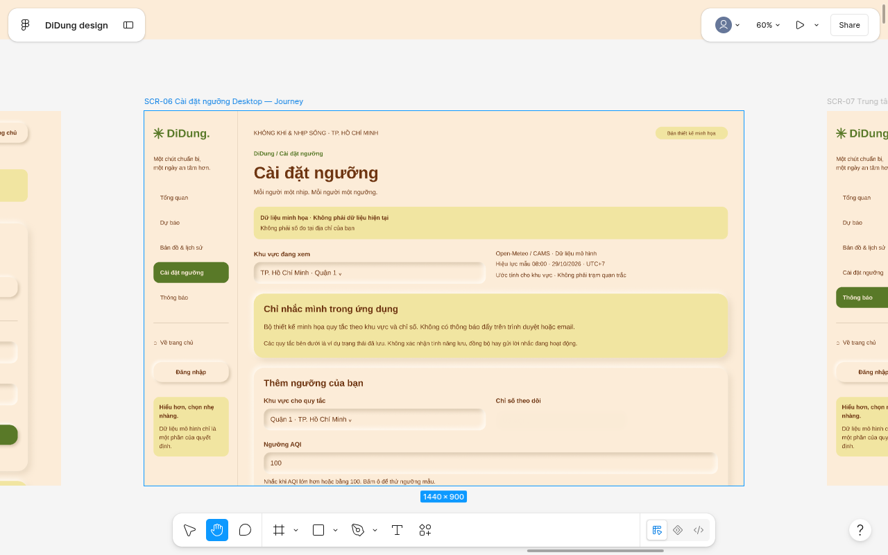
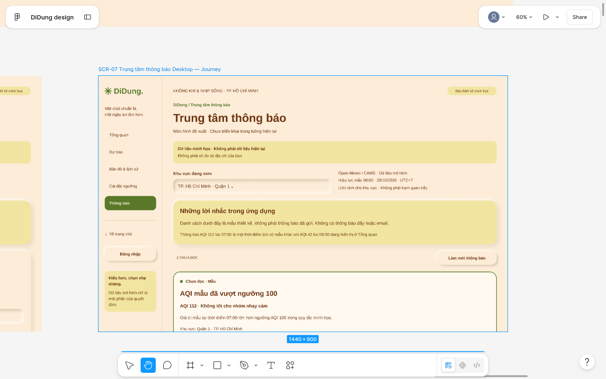

# PA3 — Assigned sections for Nguyễn Thành Đạt

Ready-to-insert English draft for **§4.2, §4.6, §6.1, §6.2 and §6.3 only**. Replace only the corresponding assigned placeholders in 10-PA3; preserve all other authors' sections, the existing §4.4 figures and existing AI log. The final AI-log row below is a separate append instruction, not a replacement log.

Source baseline: repository HEAD `7fddaabf7ea5451b1d0cb22f85ac47ae30cc6032`, inspected 16 November 2026; supplied current Google Doc text and Jira snapshot; committed PA2 PDF; existing preview/Figma assets; attributed parent browser evidence. This report documents current implementation and explicitly marks proposed designs, incomplete requirements and unverified runtime evidence. No app, schema, auth, architecture, dependency or live-document change is part of this work.

Integration uses [class-diagram.mmd](class-diagram.mmd) and [screen-flow.mmd](screen-flow.mmd) as editable figures. Full text and design images are embedded below; standalone supporting files are [patterns](design-patterns.md), [screen specifications](screen-specifications.md) and [accessibility review](accessibility-review.md). The parent subsequently rendered both complete sources and five readable class-detail panels with Mermaid CLI 12.2.0; see rendered/README.md for provenance. Full figures are overviews; use the detail panels for operations.

---

## 4.2 Class Diagram (DID-77)

DiDung uses functional TypeScript rather than a conventional object-oriented class system. Figure 4.2-1 represents existing modules, hooks, Zustand stores, route handlers and data transfer types as design-level class-diagram boxes. Names such as `EnvironmentHooks`, `CurrentAirQualityRoute` and `SupabaseClients` are diagram aliases for the files below; they are not proposed or implemented classes. `ApiError extends Error` is an actual class. Public operations are exported functions or actions returned by hooks/stores. The `Reading`/`AirReading` generalization represents a TypeScript intersection extension, not runtime inheritance.

The three packages follow the declared MVVM architecture: Model is `src/lib` plus API route handlers; ViewModel is `src/hooks` and `src/stores`; View is route components and presentation components. Server page guards call the authorization Model before rendering interactive Views. Dashed arrows show dependencies, not ownership. Aggregations describe collections without claiming exclusive object lifetimes.

**Figure 4.2-1. Source-backed design abstractions grouped by MVVM package.** Editable source: [class-diagram.mmd](class-diagram.mmd).

```mermaid
classDiagram
direction LR
%% Design abstractions of existing functions, hooks, stores and DTOs, not new OO classes.
%% Module labels and operation crosswalk are documented in pa3-assigned-sections.md section 4.2.
namespace Model {
  class ApiClient {
    <<module>>
    +apiRequest(path, options) Promise~T~
    +errorMessage(error) string
  }
  class ApiError {
    <<class>>
    +number status
    +constructor(status, message)
  }
  class Presentation {
    <<module>>
    +airPresentation(value)
    +numberText(value, digits) string
    +timeText(value) string
    +isOld(value) boolean
    +chartPresentation(items, period)
  }
  class CurrentAirQualityRoute {
    <<routeModule>>
    +GET(request) Promise~Response~
  }
  class ThresholdCollectionRoute {
    <<routeModule>>
    +GET() Promise~Response~
    +POST(request) Promise~Response~
  }
  class ThresholdItemRoute {
    <<routeModule>>
    +PATCH(request, params) Promise~Response~
    +DELETE(request, params) Promise~Response~
  }
  class AirSyncRoute {
    <<routeModule>>
    +POST(request) Promise~Response~
  }
  class WeatherSyncRoute {
    <<routeModule>>
    +POST(request) Promise~Response~
  }
  class EvaluateAlertsRoute {
    <<routeModule>>
    +POST(request) Promise~Response~
  }
  class OpenMeteo {
    <<module>>
    +fetchAirQualityForLocations(locations, forecastDays) Promise~AirQualityResult[]~
    +fetchWeatherForLocations(locations, forecastDays) Promise~WeatherResult[]~
    +toUtcIso(openMeteoTime) string
  }
  class SupabaseClients {
    <<moduleGroup>>
    +createClient() SupabaseClient
    +createAdminClient() SupabaseClient
  }
  class RequireUser {
    <<module>>
    +authenticatedClient()
    +unauthorizedResponse()
  }
  class Authorization {
    <<module>>
    +getViewer() Promise~Viewer~
  }
  class Location {
    <<DTO>>
    +string id
    +string name
    +string slug
    +latitude
    +longitude
  }
  class Reading {
    <<DTO>>
    +string valid_at
    +Numeric pm2_5
    +Numeric us_aqi
  }
  class AirReading {
    <<DTO>>
    +string source
    +string fetched_at
    +string data_type
  }
  class Series {
    <<DTO>>
    +string data_type
    +Reading[] items
  }
  class Threshold {
    <<DTO>>
    +string id
    +string location_id
    +Metric metric
    +Numeric threshold_value
    +boolean is_active
  }
}
namespace ViewModel {
  class LocationStore {
    <<ZustandStore>>
    +Location[] locations
    +string selectedId
    +status
    +load() Promise~void~
    +select(id) void
  }
  class AuthStore {
    <<ZustandStore>>
    +User user
    +boolean loading
    +number generation
    +init() cleanup
    +signUp(email, password)
    +signInWithPassword(email, password)
    +signInWithGoogle(nextPath)
    +signOut()
  }
  class ApiResource {
    <<hook>>
    +useApiResource(url, scope, revision)
    +data
    +status
    +error
    +reload() void
  }
  class EnvironmentHooks {
    <<module>>
    +useSelectedLocation()
    +useAirQuality()
    +useWeather()
    +useAirTrend()
    +useMapSnapshot()
  }
  class AccountHooks {
    <<module>>
    +useAccountIdentity()
    +useAccountMutation(scope)
    +useThresholds(scope)
    +useNotifications(scope)
    +useProfile(scope)
  }
  class AuthForm {
    <<hook>>
    +useAuthForm(nextPath)
    +submit()
    +google()
    +changeMode(next)
  }
  class MapCanvas {
    <<hook>>
    +useMapCanvas(items, selectedId, select)
  }
}
namespace View {
  class DashboardExperience {
    <<component>>
    +DashboardExperience()
  }
  class LoginForm {
    <<component>>
    +LoginForm(callbackError, nextPath)
  }
  class AppProvider {
    <<component>>
    +AppProvider(children)
  }
  class GuardedPages {
    <<routeModuleGroup>>
    +AppPage()
    +AuthPage(searchParams)
    +AdminPage()
    +ForbiddenPage()
  }
}
DashboardExperience ..> EnvironmentHooks : reads prepared state
DashboardExperience ..> AccountHooks : thresholds and sign-out
DashboardExperience ..> LocationStore : subscribes and selects
DashboardExperience ..> MapCanvas : renders map
LoginForm ..> AuthForm : binds events and feedback
AppProvider ..> AuthStore : init and cleanup
AppProvider ..> LocationStore : load after sign-in
GuardedPages ..> Authorization : server role guard
GuardedPages ..> DashboardExperience : app page renders
GuardedPages ..> LoginForm : auth page renders
AuthForm ..> AuthStore : auth actions
EnvironmentHooks ..> LocationStore : selected location
EnvironmentHooks ..> ApiResource : resource lifecycle
EnvironmentHooks ..> Presentation : display projection
AccountHooks ..> AuthStore : identity and generation
AccountHooks ..> LocationStore : threshold location
AccountHooks ..> ApiResource : account-scoped reads
AccountHooks ..> ApiClient : mutations
ApiResource ..> ApiClient : same-origin HTTP
ApiClient ..> ApiError : throws on failure
ApiClient ..> CurrentAirQualityRoute : GET current AQI
ApiClient ..> ThresholdCollectionRoute : GET or POST
ApiClient ..> ThresholdItemRoute : PATCH or DELETE
CurrentAirQualityRoute ..> RequireUser : authenticate
RequireUser ..> SupabaseClients : server client
Authorization ..> SupabaseClients : server client
AuthStore ..> SupabaseClients : browser client
ThresholdCollectionRoute ..> SupabaseClients : server client
ThresholdItemRoute ..> SupabaseClients : server client
AirSyncRoute ..> OpenMeteo : fetchAirQualityForLocations
WeatherSyncRoute ..> OpenMeteo : fetchWeatherForLocations
AirSyncRoute ..> SupabaseClients : admin client and persistence
WeatherSyncRoute ..> SupabaseClients : admin client and persistence
EvaluateAlertsRoute ..> SupabaseClients : admin client and persistence
CurrentAirQualityRoute ..> AirReading : returns projection
ThresholdCollectionRoute ..> Threshold : returns projection
ThresholdItemRoute ..> Threshold : PATCH returns projection
Reading <|-- AirReading : TypeScript intersection extension
Series "1" o-- "0..*" Reading : items
LocationStore "1" o-- "0..*" Location : loaded catalog
LocationStore --> "0..1" Location : selected entry
Location "1" -- "0..*" Threshold : location_id persisted FK
note for SupabaseClients "Browser createClient is synchronous; server createClient is async. SDK may reuse browser client. No application singleton is implied."
note for AccountHooks "useThresholds exposes save, edit, cancel, toggle, remove. useNotifications exists but has no reachable notification center."
```

### Diagram-to-source map

| Diagram alias | Existing implementation and operations |
|---|---|
| ApiClient / ApiError / Presentation | [client.ts](../../../src/lib/api/client.ts), lines 1–30: `ApiError`, `apiRequest`, `errorMessage`; [presentation.ts](../../../src/lib/api/presentation.ts), lines 4–51: formatting, stale check and chart projection. |
| CurrentAirQualityRoute / RequireUser | [current AQI route](../../../src/app/api/air-quality/current/route.ts), `GET(request)`; [require-user.ts](../../../src/lib/api/require-user.ts), `authenticatedClient` and `unauthorizedResponse`. |
| ThresholdCollectionRoute / ThresholdItemRoute | [collection](../../../src/app/api/me/thresholds/route.ts): `GET`, `POST`; [item](../../../src/app/api/me/thresholds/[id]/route.ts): `PATCH`, `DELETE`. Owner identity is resolved server-side. |
| AirSyncRoute / WeatherSyncRoute / EvaluateAlertsRoute | [air sync](../../../src/app/api/sync/air-quality-model/route.ts), [weather sync](../../../src/app/api/sync/weather/route.ts), [evaluation](../../../src/app/api/jobs/evaluate-alerts/route.ts): separate exported `POST(request)` handlers. No user-facing ViewModel participates in these scheduled jobs. |
| OpenMeteo | [open-meteo.ts](../../../src/lib/open-meteo.ts), lines 76–103: `fetchAirQualityForLocations`, `fetchWeatherForLocations`, `toUtcIso`; private batching normalizes single/multiple results. |
| SupabaseClients / Authorization | [browser](../../../src/lib/supabase/client.ts), [server](../../../src/lib/supabase/server.ts), [admin](../../../src/lib/supabase/admin.ts) factories; [authorization](../../../src/lib/auth/authorization.ts), `getViewer`. The grouped `createClient` name is exported separately from browser/server modules; server version returns a Promise. |
| Location / Reading / AirReading / Series / Threshold | Existing types in [api/types.ts](../../../src/lib/api/types.ts), lines 1–11. `Numeric` is `number \| string \| null`; diagram fields are abbreviated, not replacement contracts. |
| LocationStore / AuthStore | [location-store.ts](../../../src/stores/location-store.ts), line 10: `useLocationStore`, `load`, `select`; [auth-store.ts](../../../src/stores/auth-store.ts), line 15: `useAuthStore`, auth lifecycle and sign-in/signup/sign-out actions. `user` can be null. |
| ApiResource / EnvironmentHooks | [use-api-resource.ts](../../../src/hooks/use-api-resource.ts), line 6; [use-environment.ts](../../../src/hooks/use-environment.ts), lines 8–42. `reload` is a returned resource action; trend hook returns `setPeriod`. |
| AccountHooks / AuthForm / MapCanvas | [use-account.ts](../../../src/hooks/use-account.ts), lines 11–85: identity, mutation, thresholds, notifications, profile; [use-auth-form.ts](../../../src/hooks/use-auth-form.ts), line 5: mode/actions/feedback; [use-map-canvas.ts](../../../src/hooks/use-map-canvas.ts), line 6: map lifecycle. These are functions with per-invocation React state, not global instances of classes. |
| DashboardExperience / LoginForm / AppProvider / GuardedPages | [dashboard](../../../src/app/_components/experience/dashboard-experience.tsx), line 83; [LoginForm](../../../src/app/_components/live/login-form.tsx), line 3; [provider](../../../src/app/_components/live/app-provider.tsx), line 8; route functions in [app](../../../src/app/app/page.tsx), [auth](../../../src/app/auth/page.tsx), [admin](../../../src/app/admin/page.tsx), [forbidden](../../../src/app/forbidden/page.tsx). |

The figure emphasizes the four existing §4.4 scenarios rather than drawing every route. Additional source-backed read endpoints used by `EnvironmentHooks` are `GET /api/weather/current`, `/api/advisories/current`, `/api/air-quality/history`, `/api/air-quality/forecast`, and `/api/map/snapshot`; location catalog is `GET /api/locations`. `AccountHooks` also reads/updates `/api/me` and has a notification read/mark-read implementation; the latter is not a reachable center in the current View. These use the same Model HTTP boundary and resource lifecycle.

### Relationships and multiplicity

`LocationStore` holds **0..*** catalog entries and selects **0..1** entry; an empty catalog leaves no selection. One `Series` contains **0..*** `Reading` values, so an empty successful series is valid. Each persisted threshold references exactly **1** location; a location may have **0..*** thresholds. The DTO projects this relation through `location_id`; ownership fields are enforced at the API/database boundary and omitted from the returned threshold DTO.

For the §4.4 evaluation flow, the existing [user-domain migration](../../../supabase/migrations/20261022160549_create_user_domain_tables.sql), lines 19–44, establishes one auth user to zero-or-more thresholds and notifications; each threshold belongs to one user. Each stored notification can retain zero-or-one threshold reference (`ON DELETE SET NULL`) and zero-or-one location reference. A threshold can therefore relate to zero-or-more notifications over time. These are persisted-data relations, not evidence that notification DTOs expose every FK or that a notification screen is reachable. Environment/advisory tables similarly reference one location per row; the complete schema belongs to the existing §5 and is not replaced here.

### Alignment with existing §4.4 participants and messages

The supplied text export omits sequence images. The parent later supplied [sequence-alignment.md](sequence-alignment.md) and the original four PNGs outside the repository; all four images were visually inspected during this run. The existing participants/messages below are preserved as design vocabulary and mapped to actual source, rather than implemented as invented classes or methods.

| Existing sequence | Participants → source-backed aliases | Existing message → actual operation / behavior |
|---|---|---|
| UC-01 — View current AQI | User; View → `DashboardExperience`/`AirCard`; AQ VM → `EnvironmentHooks` + `ApiResource`; AQ API → `CurrentAirQualityRoute`; Auth → Supabase Auth via `RequireUser`; Database → Supabase PostgreSQL | `read()` → `useAirQuality()`; `getCurrent(locationId)` → `apiRequest` to current endpoint and route `GET(request)`; `getUser()` → SDK `auth.getUser()`; `readCurrent(locationId, now)` → `.from("air_quality_model").select(...).eq(...).lte(...).order(...).limit(1).maybeSingle()`; `isOld(validAt)` → actual `isOld(valid_at)` through the hook. 401/404/500 produce distinct resource states. |
| UC-06 — Create threshold | User; View → `ThresholdCard`; Threshold VM → `AccountHooks.useThresholds` and `useAccountMutation`; Threshold API → `ThresholdCollectionRoute`; Auth and Database → server SDK | `save()` → returned hook action; `create(input)` → `apiRequest` POST then exported route `POST(request)`; `insertThreshold(userId,input)` → owner-derived `.from("alert_thresholds").insert(...).select(...).single()`; `list(scope)` → mutation revision changes the identity of `useApiResource`, causing GET re-read. These sequence names are not separate exported functions. Validation and account-generation checks may stop/suppress UI completion. |
| UC-08 — Separate ingestion jobs | Scheduler; SyncAPI → `AirSyncRoute` **or** `WeatherSyncRoute`; OpenMeteoAdapter → `OpenMeteo`; Database → admin SDK | `run(request, cron secret)` → `POST(request)` with `x-cron-secret` check and `createAdminClient`; `readActiveLocations()` → locations query; `fetchAirQuality` / `fetchWeather` → actual `fetchAirQualityForLocations` / `fetchWeatherForLocations`; `upsertAir` / `upsertWeather` → upsert `air_quality_model` on `(location_id,valid_at)` / `weather_data` on `(location_id,valid_at,is_forecast)`; `appendSyncLog` → insertion into `data_sync_log`. Null source fields map to null; this is not full schema validation/rejection logging. |
| UC-11 — Evaluate thresholds | Scheduler; AlertJobAPI → `EvaluateAlertsRoute`; Database → admin SDK | `evaluate-alerts(cron secret)` → exported `POST(request)` after secret validation/client initialization; `readActiveThresholds()` and `readEligibleAir()` → SDK queries over active rules and the inclusive last-three-hour window through now; `upsertNotifications(candidates)` → `.upsert(rows, {onConflict:"dedup_key", ignoreDuplicates:true})`; `appendSyncLog` → log insert. Candidate condition is value **>=** threshold; key is `threshold.id + ":" + now.toISOString().slice(0,10)` (UTC date). Returned count is candidate count, not measured newly inserted count after deduplication. |

No source operation named `getCurrent`, `readCurrent`, `insertThreshold`, `upsertAir` or `readEligibleAir` is invented by this diagram. They remain descriptive §4.4 messages backed by the actual calls above. Existing §4.4 remains untouched; any requested change to its participant names belongs to its author/integration step.

Notation was checked against [official Mermaid class diagrams](https://mermaid.js.org/syntax/classDiagram.html): namespaces, stereotypes, dependency arrows, generic notation and quoted cardinality. No application classes or schema were added.

---

## 4.6 Design Principles and Patterns (DID-78)

Source baseline: local HEAD `7fddaabf7ea5451b1d0cb22f85ac47ae30cc6032`, inspected 16 November 2026. These are descriptions of existing implementation, not architecture changes or claims that every pattern suggested in DID-78 is present.

| Principle / pattern | Where it is applied | Reason and evidence boundary |
|---|---|---|
| MVVM with functional modules | [Environment hooks](../../../src/hooks/use-environment.ts), lines 8–42; [account hooks](../../../src/hooks/use-account.ts), lines 11–85; [dashboard](../../../src/app/_components/experience/dashboard-experience.tsx), lines 29–99; [HTTP Model boundary](../../../src/lib/api/client.ts), line 6; API route handlers | Views bind prepared values and actions. Hooks coordinate resource state, selection and mutations; Model modules query persistence and format domain data. This is the repository's declared MVVM architecture. Server page guards still call the authorization Model directly, and `useMapCanvas` builds Mapbox popup DOM; the implementation is not an absolute separation of every presentation detail. |
| Reactive store subscriptions, Observer-style | [Location store](../../../src/stores/location-store.ts), line 10; [auth store](../../../src/stores/auth-store.ts), lines 15–35; hook selectors in [use-environment.ts](../../../src/hooks/use-environment.ts), lines 9–10 | Zustand state changes update consuming React hooks. Auth additionally subscribes to Supabase `onAuthStateChange` and returns an unsubscribe cleanup from `init`. This provides notification/subscription behavior; there is no custom GoF Subject/Observer class hierarchy. Zustand's documented `create` returns a hook with store utilities. |
| Provider adaptation (Adapter-style module) | [open-meteo.ts](../../../src/lib/open-meteo.ts), lines 46–103; [air ingestion](../../../src/app/api/sync/air-quality-model/route.ts), lines 39–55; [weather ingestion](../../../src/app/api/sync/weather/route.ts), lines 39–64 | The provider module batches coordinates, normalizes a single object versus a list into location-tagged hourly results, and converts provider time strings to UTC strings. Route handlers map provider field names to stored rows. It isolates provider protocol details without implementing an Adapter interface/class. Official Open-Meteo documentation confirms multi-coordinate list responses and default GMT. |
| Client factory wrappers | [browser client](../../../src/lib/supabase/client.ts), line 3; [server client](../../../src/lib/supabase/server.ts), line 4; [admin client](../../../src/lib/supabase/admin.ts), line 6 | Functions centralize SDK construction/configuration for browser cookies, server cookies and server-only privileged jobs. These are factory functions, not a GoF Factory Method inheritance hierarchy. The async server wrapper reads the request cookie store. |
| Separation of responsibilities / limited SRP evidence | [use-api-resource.ts](../../../src/hooks/use-api-resource.ts), line 6; [presentation.ts](../../../src/lib/api/presentation.ts), lines 4–51; [require-user.ts](../../../src/lib/api/require-user.ts), line 4; [threshold routes](../../../src/app/api/me/thresholds/route.ts) | Resource lifecycle, display formatting and authentication helpers have distinct reasons to change. Shared functions reduce repetition. Route handlers still combine auth, validation, querying and response construction; this is evidence of responsibility separation, not a proof of full SOLID compliance. |
| HTTP boundary and account-scoped state | [client.ts](../../../src/lib/api/client.ts), lines 6–30; [use-account.ts](../../../src/hooks/use-account.ts), lines 11–38 | Relative requests share same-origin session cookies. Mutation completion checks user ID plus generation before updating UI state; resource identity includes scope, URL and revision. This limits stale account responses. It is a concrete design practice, not a named security or GoF pattern. |

### Suggested labels that the code does not justify

**Singleton:** do not describe all Supabase wrappers as application Singletons, or assert that every wrapper call creates a fresh browser instance. The local browser wrapper calls `createBrowserClient` without an `isSingleton` override. The installed SDK source (`node_modules/@supabase/ssr/src/createBrowserClient.ts`, lines 104–110 and 165–166) caches a browser client by default; [official SDK source](https://github.com/supabase/ssr/blob/main/src/createBrowserClient.ts) confirms that behavior. This is SDK-managed browser reuse. The repository does not implement one shared instance across browser, server requests and privileged jobs. Server/admin factory functions should be described separately.

**Strategy:** [aqiToLevel](../../../src/lib/air-quality.ts), line 12, is an ordered conditional classifier. [Alert evaluation](../../../src/app/api/jobs/evaluate-alerts/route.ts), lines 84–109, selects PM2.5 or AQI by a conditional and triggers when the selected value is **greater than or equal to** the threshold. There are no interchangeable strategy objects, injected comparison policies or configurable comparator in the current implementation. PA2's broader comparator requirement must not be reported as implemented.

**Dependency Inversion Principle:** views usually depend on hooks and Model functions, but hooks/routes import concrete modules and Supabase directly. No application-defined repository/provider interface with injected implementations was found in these paths. Report layered dependency direction and concrete imports, not formal DIP conformance.

**Do not infer a notification event bus:** the scheduled evaluator inserts notification rows with a daily deduplication key; it does not publish through a browser Observer or a demonstrated realtime channel. The notification hook performs HTTP reads. Saved-location CRUD is likewise not implied by the existence of the `user_locations` table.

### Official references verified for this draft

- [Next.js Server and Client Components](https://nextjs.org/docs/app/getting-started/server-and-client-components): execution boundary and interactive client components.
- [Zustand create](https://zustand.docs.pmnd.rs/reference/apis/create): selector hook and attached store utilities.
- [Supabase SSR client creation](https://supabase.com/docs/guides/auth/server-side/creating-a-client) and [SDK implementation](https://github.com/supabase/ssr/blob/main/src/createBrowserClient.ts): wrapper examples and browser cache behavior.
- [Open-Meteo Air Quality API](https://open-meteo.com/en/docs/air-quality-api) and [Weather API](https://open-meteo.com/en/docs): hourly data, multi-coordinate result shape and timezone defaults.

Sources were opened on 16 November 2026. They establish API semantics; pattern labels above are interpretations supported by the cited repository files. No packages or versions were installed or changed.

---

## 6.1 Screen List and Screen Flow (DID-79)

The inventory retains PA2 screen identifiers and maps them to the current implementation. PA2 §6.3 (pp. 14–15) defines UC-01–11 and **UC-15 — View landing page**; §7 distinguishes background processes and unimplemented requirements. The PA2 accessibility report's older provisional mapping is supporting evidence rather than the authority for UC names. No UC numbering is invented.

**Figure 6.1-1. Current navigation, embedded dashboard regions and explicit implementation gaps.** Editable source: [screen-flow.mmd](screen-flow.mmd). Nodes for dashboard regions describe contained UI, not separate routes; dotted arrows annotate states.

### Screen inventory and requirements coverage

| ID / screen | Route / composition | Related PA2 use cases | Access, current behavior and states |
|---|---|---|---|
| SCR-01 landing | `/`; hero, story, features, sources, account gate | UC-15; entry to UC-04 | Public illustrative content; source does not fetch live environmental data in demo hooks. Existing sessions redirect by role. Example good/bad/missing states and a signed-out account prompt. |
| SCR-02 overview | `/app`: AQI, PM2.5, weather, advice; shared area selector | UC-01, UC-09, UC-10 | Signed in (user/admin). Latest stored current readings, model/source/time, stale flags for AQ/weather. Loading, no area/catalog, empty current row, error/unauthorized; catalog retry. Numeric missing values remain dashes. |
| SCR-03 forecast | `/app` trend card; `/forecast` redirects here | Partial UC-02, plus UC-09/10 | US AQI forecast is implemented; PM2.5 forecast chart, 1–6h requirement conformance and provider issue-time are not established. Period toggle defaults forecast; loading/error/no-points states. |
| SCR-04 map/history | `/app#app-map`; history is the shared trend period | UC-03, UC-09/10 | Conditional Mapbox with snapshot readings and popup selection; history defaults past 24h. No UI time slider/date range. No-token/map-error guidance; missing snapshot values; ready-empty map has no dedicated empty message. |
| SCR-05 authentication | `/auth`; login/signup modes; `/login` redirects | UC-04 | Public sign-in/email registration/Google; required email/password, signup length, pending/error/confirmation states. Successful completion uses safe authorized return path or role default. No forgot-password UI. |
| SCR-06 thresholds | `/app#app-thresholds`, with shared area selector | UC-06; UC-05 remains a gap | Owner rule list/create/edit/enable/disable/delete. Empty/loading/unauthorized/read-error and validation/pending/mutation-success/failure. Catalog selection is a local preference, not saved-location management. |
| SCR-07 notification center | No active page; `/notifications` redirects to threshold anchor | UC-07 remains a reachability gap; UC-11 creates rows in background | Existing APIs/hook/component support list/unread count/mark-read, but current dashboard and landing do not render `LiveAlertPanel`. Figma design is proposed; no reachable-center runtime states claimed. |
| Saved-location management | No product CRUD route or View found | UC-05, required but unimplemented | `user_locations` exists in schema, but selecting an active catalog location/localStorage is not account-owned CRUD. No fabricated screen or states. |
| Account/profile | `/profile` redirects to `/app`; landing `#account` contains gate/ProfilePanel | Supporting account behavior, no new UC ID assigned | Normally signed-in `/` redirects before profile editing is shown. Dashboard exposes identity/sign-out, not the dormant profile edit form. Gate has loading/signed-out messaging. |
| Admin shell | `/admin` | Supporting role navigation; does not establish optional UC-14 monitoring | Exact admin metadata required. Placeholder management labels; link to `/app`; sign-out pending/error. No implemented users/data/sync management screens. |
| Forbidden | `/forbidden` | Supporting role-denial state; no new UC ID | Authenticated ordinary users see return-to-app/sign-out; admins go to `/admin`, anonymous users to `/auth`. Displayed 403 text is a UI state; no HTTP status claim. |
| Authentication callback | `/auth/callback` | UC-04 supporting transition | Code/session exchange and role-safe destination; error returns auth guidance. Not a separate designed product screen. |
| Legacy entry routes | `/demo` → `/`; `/story`, `/features`, `/data-sources` → `/#how-it-works`; `/air-quality`, `/weather`, `/forecast`, `/profile` → `/app`; `/map` → map anchor; `/notifications` → threshold anchor; `/login` → `/auth` | Destination UC mappings above | Redirect handlers have no independent screen UI. Record destinations literally; do not claim separate forecast/profile/notifications pages. |
| Ingestion / evaluation | `/api/sync/air-quality-model`, `/api/sync/weather`; `/api/jobs/evaluate-alerts` | UC-08 and UC-11 | Scheduled server workflows, not screens. UI source/time/missing states do not prove a particular job ran successfully. |

UC-09 (source/time/provenance) and UC-10 (stale/unavailable) span environmental regions; they are not separate navigation destinations. UC-08 and UC-11 remain background workflows. The distinction preserves all assigned UC-01–11/15 traceability while recording partial/missing implementation rather than silently altering PA2 requirements.

### Auth/role navigation and recovery

Anonymous users opening `/app` or `/admin` are sent to `/auth` with a requested destination. Successful auth validates internal return paths and blocks ordinary-user admin returns. Default destinations are `/app` for users and `/admin` for admins. An admin may open the user dashboard; an ordinary authenticated `/admin` visit redirects to `/forbidden`. Only exact `user.app_metadata.app_role === "admin"` grants admin. Sign-out navigates to `/` only after store success; otherwise visible error remains. Auth/session loss can redirect the dashboard to `/auth`; per-resource 401 responses also have unauthorized text and are not successful empty data.

Resource state is not synonymous with a screen: `useApiResource` starts idle without a URL, loading while a current identity has no response, ready on success, empty on HTTP 404, unauthorized on 401, and error otherwise. Successful empty arrays need their View's explicit empty message; `TrendCard`/`ThresholdCard` have one, `MapCard` does not. Stale labels apply where their hooks expose them. The resource `reload` action exists, but most active dashboard cards do not render a retry button; catalog retry is explicitly available. No cross-screen automatic retry, realtime update or complete error recovery is claimed.

Source: route files under [src/app](../../../src/app), [authorization](../../../src/lib/auth/authorization.ts), [auth navigation](../../../src/lib/auth-navigation.ts), [dashboard](../../../src/app/_components/experience/dashboard-experience.tsx), [resource hook](../../../src/hooks/use-api-resource.ts), [notification component](../../../src/app/_components/live/account-panels.tsx), and [PA2 PDF](../../../pa/PA2/10-PA2.pdf). Existing design references for every screen/gap are in §6.2. Flowchart notation follows [official Mermaid syntax](https://mermaid.js.org/syntax/flowchart.html).

---

## 6.2 Screen Specifications (DID-80)

The six key specifications below retain PA2 screen IDs while describing the current route composition. SCR-02, SCR-03, SCR-04 and SCR-06 are regions of one protected `/app` page, not four standalone pages. UC identifiers come from [PA2 §6.3, pp. 14–15 and §7](../../../pa/PA2/10-PA2.pdf). UC-02 is titled **View PM2.5 forecast** in PA2; the current chart displays **US AQI**, so this is partial coverage, not full satisfaction of UC-02.

All designs use the cream/brown/olive palette and raised/inset surfaces in [design.md](../../../design.md). Design references show visual intent, not automatic approval of every implementation detail. No app UI was changed for this report.

### Design evidence register

| Ref | Existing design / image | Scope and limitation |
|---|---|---|
| D1 | [Frontend HTML preview](../../previews/2026-10-27-frontend-preview.html), sections `#auth`, `#app`, `#app-map`, `#app-thresholds` | Earlier editable mockup with sample data. Use its top buttons to select Auth or After sign-in; `#app` alone does not activate its hidden section. Its chart shows both series and its thresholds lack current CRUD controls. Its landing replacement link points to a file absent from this checkout. |
| D2 | [PA2 Figma design](https://www.figma.com/design/Ev67pGKl766yRwq4R7nu7G/DiDung-design?node-id=24-30405); repository [reference](../figma-design-for-frontend) | External design reference. Direct web-reader access failed in this run. Parent-supplied desktop Figma viewport captures F1–F7 are now available locally and were inspected in this run. They include editor chrome at fit zoom; original-resolution exports and immutable version IDs are still absent. Mobile frame descriptions below remain attributed to the PA2 review. |
| D3 | [Overview mobile frame 24:26057](https://www.figma.com/design/Ev67pGKl766yRwq4R7nu7G/DiDung-design?node-id=24-26057) | PA2 recorded a 390px overview with AQI/PM2.5 and a trend chart. See [PA2 review E01](../pa2/accessibility-review.md). |
| D4 | [Auth mobile frame 24:27908](https://www.figma.com/design/Ev67pGKl766yRwq4R7nu7G/DiDung-design?node-id=24-27908) | PA2 review E02 includes a forgot-password design control; current `LoginForm` does not implement that control. |
| D5 | [Threshold mobile frame 24:28252](https://www.figma.com/design/Ev67pGKl766yRwq4R7nu7G/DiDung-design?node-id=24-28252) | PA2 review E04 records labels, save/cancel and rule actions; full state coverage and comparator semantics were not verified. |
| D6 | [Admin role shell HTML](../../previews/2026-11-02-admin-role-shell.html) | Earlier editable admin/access-denied design reference, not evidence of management workflows. |
| B1 | [Public landing desktop](evidence/landing1440.png), [mobile](evidence/landing390.png) | Parent-supplied production captures; viewed in this run. Deployment commit unverified. The production selector differs from local source's disabled illustrative selector. |
| B2 | [Public air chapter](evidence/chapter-air1440.png), [trend chapter](evidence/chapter-trend1440.png) | Parent-supplied public-page images, viewed here. They display provider/time labels on production; they are not authenticated `/app` evidence and must not redefine the local illustrative implementation. |
| B3 | [Login desktop](evidence/login1440.png), [mobile](evidence/login390.png), [registration mode](evidence/signup1440.png) | Viewed here. Production `/login` has mode buttons and shared header/footer; local `/login` redirects to the split-layout `/auth` page. Useful visual references, not exact local-layout captures. |
| B4 | [Alert chapter](evidence/chapter-alert1440.png), [file named map1440](evidence/map1440.png) | Viewed here. Alert image shows a signed-out login prompt. The map-named image shows a **collapsed disclosure and weather content**, not an expanded map. Neither proves threshold CRUD, notification review or map interaction. |

F1–F7 are existing design captures, not a new mockup or implementation approval. The parent recorded their node URLs in [figma-evidence.md](figma-evidence.md) and [capture metadata](evidence/figma-captures.json). All seven were visually inspected in this run.

| Ref | Existing desktop design capture | Figma node |
|---|---|---|
| F1 | [SCR-01 landing](evidence/figma-scr01-desktop.png) | [24:32090](https://www.figma.com/design/Ev67pGKl766yRwq4R7nu7G/DiDung-design?node-id=24-32090) |
| F2 | [SCR-02 overview](evidence/figma-scr02-desktop.png) | [24:31664](https://www.figma.com/design/Ev67pGKl766yRwq4R7nu7G/DiDung-design?node-id=24-31664) |
| F3 | [SCR-03 forecast](evidence/figma-scr03-desktop.png) | [24:31378](https://www.figma.com/design/Ev67pGKl766yRwq4R7nu7G/DiDung-design?node-id=24-31378) |
| F4 | [SCR-04 map/history](evidence/figma-scr04-desktop.png) | [24:31108](https://www.figma.com/design/Ev67pGKl766yRwq4R7nu7G/DiDung-design?node-id=24-31108) |
| F5 | [SCR-05 auth](evidence/figma-scr05-desktop.png) | [24:30889](https://www.figma.com/design/Ev67pGKl766yRwq4R7nu7G/DiDung-design?node-id=24-30889) |
| F6 | [SCR-06 thresholds](evidence/figma-scr06-desktop.png) | [24:30726](https://www.figma.com/design/Ev67pGKl766yRwq4R7nu7G/DiDung-design?node-id=24-30726) |
| F7 | [SCR-07 notifications](evidence/figma-scr07-desktop.png) | [24:30513](https://www.figma.com/design/Ev67pGKl766yRwq4R7nu7G/DiDung-design?node-id=24-30513) |

Parent provenance and limited deployment observations are preserved in [browser-evidence.md](browser-evidence.md) and [JSON observations](evidence/browser-observations.json). No new browser execution was performed in this documentation run.

### SCR-01 — Public landing (UC-15)

**Route and access:** `/`, anonymous entry. Authenticated users redirect to `/app` or `/admin` according to role. Local landing data is explicitly illustrative and uses no live environmental API through its demo hooks. Design: F1, D2 and B1; earlier D1 landing is superseded according to its own banner.

| Control | Type / validation | Event handling |
|---|---|---|
| Brand, story/features/sources navigation and story rail | Links; section navigation managed by `LandingLink` | Move to the relevant landing section; sign-in links open `/auth`. |
| Illustrative location | Disabled select in local `LandingDemoToolbar` | No selection event or location persistence. Production B1's enabled-looking selector must not be claimed as local functionality. |
| Good / bad / missing example | Buttons in a labeled fieldset; `aria-pressed` state | `useAirDemo().setScenario` changes example values and explanatory text; missing displays a dash, not a good AQI. |
| History / forecast demonstration | Buttons | `useTrendDemo().setPeriod` switches illustrative series. No protected forecast request occurs here. |
| Sign in / threshold prompt | Link | Opens authentication; wording about notifications is a product description, not proof that a notification center is reachable. |

**States:** example scenarios include missing data. Timed example changes pause at initial reduced-motion preference. The account region uses `AccountGate`: checking-session feedback or signed-out prompt; server-side role redirect normally prevents an authenticated landing/profile screen. There is no live loading/error contract for the demo values. **Image gap:** B1 is a deployment reference, not a capture of this local revision; current illustrative states still need local/current-build captures.

**Source:** [page.tsx](../../../src/app/page.tsx), lines 14–33; [landing toolbar](../../../src/app/_components/demo/landing-toolbar.tsx); [demo air panel](../../../src/app/_components/demo/air-panel.tsx); [demo hooks](../../../src/hooks/use-landing-demo.ts); [navigation](../../../src/hooks/use-landing-navigation.ts).

### SCR-02 — Current AQI dashboard, weather and advice (UC-01, UC-09, UC-10)

**Route and access:** `/app`; signed-in users and admins. `AppPage` redirects anonymous users to `/auth?next=/app`. Design: F2, D1 `#app`, D3. B2's air chapter is supporting visual context only. **Runtime image gap:** F2 supplies the required existing design image; no authenticated current-dashboard screenshot is available. F2 depicts a separate overview page and illustrative values, whereas local source combines multiple regions.

| Control | Type / validation | Event handling |
|---|---|---|
| Current area | Labeled select populated by `/api/locations`; disabled until ready or when catalog empty | `LocationStore.select(id)` accepts only catalog IDs; stores selected ID in localStorage when available. Dependent hooks request data for that location. This is not UC-05 saved-location CRUD. |
| AQI and PM2.5 card | Read-only value, category, unit, model/source and valid time | `useAirQuality` projects the latest stored row with `valid_at <= now`. Invalid/missing numeric values display `—`; `airPresentation` handles missing before category classification. |
| Weather and advice cards | Read-only precipitation probability, humidity, wind, rain; summary/action/note | `useWeather` reads current weather and advisory endpoints independently; source/time and stale weather text are displayed. Advice shows model identity and a general-advice disclaimer. |
| Sidebar overview/map/thresholds | Anchor links | Move within `/app`; no separate forecast screen link is present in this sidebar. |
| Retry location / sign out | Button; sign-out disabled while pending | Catalog retry calls `load`; sign out calls the store, then replaces with `/` and refreshes. Failure preserves the page and displays an alert. |

**States:** initial auth check; catalog loading/error/empty; resource idle/loading/404-empty/401-unauthorized/error/ready. Current AQI and weather flag valid times older than three hours; this is a display rule, not proof of ingestion freshness. Individual cards expose error text but **do not render their resource `reload` buttons** in the active dashboard. Retry is explicit for the location catalog; page reload or a dependency change can re-request other data. Empty weather/advice and API failures must not be filled with demo data.

**Source:** [dashboard](../../../src/app/_components/experience/dashboard-experience.tsx), lines 11–44, 56–62, 83–99; [environment hooks](../../../src/hooks/use-environment.ts), lines 8–28; [presentation](../../../src/lib/api/presentation.ts), lines 4–25; [resource lifecycle](../../../src/hooks/use-api-resource.ts), lines 6–25.

### SCR-03 — Forecast region (partial UC-02; UC-09, UC-10)

**Route and access:** `TrendCard` within `/app`; legacy `/forecast` redirects to `/app`. Design: F3, D1 `#app` chart and D3. B2 trend image is a public deployment reference. **Runtime image gap:** F3 supplies an existing design image; no authenticated current forecast capture is available. F3 explicitly labels its separate page as proposed/not independently implemented and shows design-only issue-time information.

| Control | Type / validation | Event handling |
|---|---|---|
| History / forecast | Two buttons in a named group; `aria-pressed` | `setPeriod("history" \| "forecast")` changes the endpoint. Initial period is forecast. |
| Hourly chart | SVG with title and description, hour labels and caption | `chartPresentation` orders valid times, excludes invalid numeric points, breaks paths across missing values and draws forecast dashed/history solid. |
| Selected area | Shared SCR-02 select | Changes the location ID used by the current series request. |

**Data and validation:** UI supplies no date picker, horizon input, metric selector or forecast issue-time field. Forecast API defaults to 24 hours and caps its `hours` parameter at 72; the UI sends no `hours` override. It reads future rows already in `air_quality_model`, not the separate `forecasts` table. PM2.5 is returned by the endpoint but **is not drawn** in `TrendCard`. Do not claim PA2's PM2.5/1–6-hour/issue-time requirements are all implemented.

**States:** loading, unauthorized, error, HTTP 404-empty via common resource helper; a successful response with no usable chart points shows explicit no-points text. The chart description gives series type, count and timezone, not a complete textual list of the hourly values. No forecast-specific retry control is rendered in the active dashboard.

**Source:** [TrendCard](../../../src/app/_components/experience/dashboard-experience.tsx), lines 46–54; [useAirTrend](../../../src/hooks/use-environment.ts), lines 30–34; [forecast route](../../../src/app/api/air-quality/forecast/route.ts); [chart projection](../../../src/lib/api/presentation.ts), line 26.

### SCR-04 — Map and history (UC-03, UC-09, UC-10)

**Route and access:** `/app#app-map`, with history in the same page's trend region; legacy `/map` redirects to the map anchor. Design: F4, D1 `#app-map` placeholder and trend chart. **Runtime image gap:** F4 supplies the existing map/history design image, explicitly labeled illustrative/proposed. `map1440.png` is collapsed public content; an expanded current authenticated Mapbox screenshot remains unavailable.

| Control | Type / validation | Event handling |
|---|---|---|
| Map navigation | Mapbox `NavigationControl`; conditional on public token configuration | Map creation uses the map hook; initialization/load errors are converted to visible text. Actual keyboard behavior remains a browser follow-up. |
| Map markers / popup action | Marker plus popup text and “Choose area” button | Finite coordinates are required for a marker. Popup contains location, AQI category/value, PM2.5, valid time and stale flag; action calls `select(location_id)`. Selected location popup opens. |
| Area list | Shared labeled select at dashboard top | Remains available without Mapbox. It selects a location but does not provide a full equivalent list of all map readings. |
| History button | Shared trend control | Requests the last 24 hours by default. There is no map time slider or UI date-range input; history is not an animated historical map. |

**States:** snapshot loading/error/unauthorized; absent token displays an explanation and directs users to the selector above. Map initialization error also displays text, although one error string says the list is “below” while the actual selector is above. Snapshot API includes active locations even when no reading exists within its three-hour window; missing values remain null and are projected to missing text. A ready empty snapshot does not have a separate dedicated empty-map message in `MapCard`.

**Source:** [MapCard](../../../src/app/_components/experience/dashboard-experience.tsx), lines 64–72; [map hook](../../../src/hooks/use-map-canvas.ts), lines 6–51; [snapshot route](../../../src/app/api/map/snapshot/route.ts); [history route](../../../src/app/api/air-quality/history/route.ts).

### SCR-05 — Sign in and registration (UC-04)

**Route and access:** `/auth`; `/login` is an alias redirect. Existing authenticated users go to their role default; successful completion may honor a safe authorized `next` path. Design: F5, D1 `#auth`, D4 and B3. B3 shows production mode buttons rather than the local text switch and split layout. **Runtime image gap:** F5 supplies an existing design image; no matching local/current-build auth screenshot is supplied. The Figma screen is illustrative and does not prove actual sign-in.

| Control | Type / validation | Event handling |
|---|---|---|
| Email | Required `type=email`, explicit label, `autocomplete=email` | Native validation precedes submit. Hook trims email before sending. |
| Password | Required `type=password`; signup minimum six characters; current/new-password autocomplete by mode | Stored only in hook state for this form; switch mode clears password and feedback. No confirm-password field is implemented. |
| Sign-in / create-account submit | Submit button; disabled for pending/auth loading | Calls password sign-in or signup. If signup returns no session, password clears and confirmation-email instructions appear; with a session, completion redirects. Registration is implemented, not merely a proposal. |
| Continue with Google | Button; disabled while pending/loading | Starts provider flow with callback and optional `next`; callback exchanges code for session. Provider/callback errors return a retryable sign-in message. |
| Switch mode / return to introduction | Button / link | Switches form mode locally or returns to `/`. No forgot-password workflow is implemented despite the PA2 design reference. |

**States and navigation:** pending processing, provider/credentials error (`role=alert`), email-confirmation instructions (`role=status`), callback failure and completion. `safeAuthRequestPath` rejects external/protocol-relative/unsafe paths and auth loops; `authPathForRole` prevents ordinary users returning to `/admin`. Only `app_metadata.app_role === "admin"` grants admin; registration does not let a user choose that role. Service-side password/email policy can return further errors; six-character HTML validation alone does not prove acceptance by Supabase.

**Source:** [LoginForm](../../../src/app/_components/live/login-form.tsx), lines 3–18; [useAuthForm](../../../src/hooks/use-auth-form.ts), lines 5–40; [auth store](../../../src/stores/auth-store.ts), lines 36–69; [auth navigation](../../../src/lib/auth-navigation.ts); [callback](../../../src/app/auth/callback/route.ts).

### SCR-06 — Personal thresholds and area selection (UC-06; UC-05 gap)

**Route and access:** `/app#app-thresholds`; owner-authenticated API operations. `/notifications` currently redirects here. Design: F6, D1 `#app-thresholds`, D5. B4 alert image illustrates only the signed-out entry. **Runtime image gap:** F6 supplies an existing threshold design image; no authenticated current create/edit/error capture is supplied. No saved-location management screen is implemented.

| Control | Type / validation | Event handling |
|---|---|---|
| Metric | Labeled select: `aqi` or `pm25`; disabled while editing/pending | `setMetric`; existing rule metric and location cannot be changed by edit. |
| Threshold | Required numeric input; AQI min 1/step 1, PM2.5 min 0.1/step 0.1 | Hook rejects blank, nonfinite, nonpositive, fractional AQI and PM2.5 off the 0.1 grid. These client rules are stricter than the route's type checks. |
| Add / save changes | Submit button; disabled if no location for creation or mutation pending | `save` POSTs location/metric/value for creation or PATCHes only value when editing. Success resets defaults and re-reads via mutation revision. |
| Edit / cancel | Buttons | Edit loads row values; cancel resets metric AQI/value 100 and clears validation. Active dashboard Edit and Cancel are not disabled while a mutation is pending, unlike several other controls. Do not claim a fully locked form. |
| Enable / disable / delete | Row buttons; disabled while mutation pending | PATCH active flag or DELETE the rule. No delete-confirmation dialog is implemented. Text states show enabled/disabled. |
| Area selector | Shared SCR-02 select | Determines location for a new rule; selection is local preference. No add/remove/list account-owned saved-location operations exist. |

**Validation boundary:** collection POST requires a location, allowed metric and numeric `threshold_value`; item PATCH accepts numeric value or boolean active flag, rejects an empty supported update, and owner-filters the target. It does not enforce all client positivity/precision rules. Database FK/RLS constraints may reject requests. This report records the mismatch rather than claiming server parity or changing validation.

**States:** list loading/empty/error/unauthorized; mutation pending, success and failure; local field validation; selected-area absence. Error/success messages use alert/status roles but are not explicitly associated with the input by `aria-describedby`/`aria-invalid`. Account identity/generation guards mutation completion. Automatic threshold evaluation is UC-11, not executed by saving the form; current evaluator uses `>=`, eligible recent data and daily deduplication.

**Source:** [ThresholdCard](../../../src/app/_components/experience/dashboard-experience.tsx), lines 74–80; [useThresholds](../../../src/hooks/use-account.ts), lines 41–64; [collection route](../../../src/app/api/me/thresholds/route.ts); [item route](../../../src/app/api/me/thresholds/[id]/route.ts); [evaluator](../../../src/app/api/jobs/evaluate-alerts/route.ts).

### Additional screens, states and design references

| Screen / artifact | Current status | Existing design reference and image gap |
|---|---|---|
| SCR-07 notification center, UC-07 | `useNotifications`, GET/mark-read APIs and `LiveAlertPanel` exist; no active route renders the center. `/notifications` redirects to thresholds. Do not present notification reading as reachable. | F7 is the existing design image at node 24:30513; it explicitly says proposed/not implemented in the current flow. B4 is only an entry prompt. No runtime center image can be claimed from either. |
| Saved-location management, UC-05 | `user_locations` table exists; account-owned CRUD screen/API not found. Local catalog selection is not its implementation. | General D2 and PA2 UC-05 requirement only; no distinct saved-location frame/image verified. Record design-image gap, not an invented screen. |
| Admin shell | `/admin`, admin-only placeholder; “View user site” and sign-out work by source; management labels are “Coming soon.” | D6 editable HTML; no current runtime image supplied. No claim that UC-14 monitoring is implemented. |
| Forbidden | `/forbidden`, ordinary authenticated users; admins redirect to `/admin`, anonymous users to `/auth`. Return-to-app/sign-out controls. | D6 access-denied view (`show('forbidden')` in its preview script); no current runtime image supplied. |
| Profile/account region | `ProfilePanel` on public landing shows an account gate. Authenticated entry normally redirects; `/profile` redirects to `/app`, whose sidebar displays identity and sign-out, not a profile edit form. | D2 general reference; no distinct profile image verified. Existing dormant edit form is not evidence of a reachable profile screen. |
| Callback, legacy redirects and resource feedback | Navigation/state mechanisms, not independent product screens | D1/D4 for destination layout; no dedicated callback/loading/error design exports locally. Required state screenshots remain a follow-up. |

All six key screens and the additional notification design now have local design captures. Original-resolution exports, immutable design versions, saved-location/profile-specific designs and current authenticated runtime images remain evidence gaps for final document assembly. They do not require implementation, new mockup approval or invented screenshots in this documentation-only task.

---

## 6.3 Accessibility Checklist (DID-81)

Assessment date: **16 November 2026**. Baseline: local source `7fddaabf7ea5451b1d0cb22f85ac47ae30cc6032`. This review combines reproducible token calculations, static source inspection and explicitly attributed parent-supplied production observations. **It does not establish a current-build runtime accessibility pass.** No browser session or screen-reader test was performed by this documentation run.

The [PA2 review](../pa2/accessibility-review.md), dated 2 November, is historical design evidence. Its Figma observations and limited PASS results do not establish PA3 implementation behavior. The [parent browser record](browser-evidence.md) describes a separate deployment session on 16 November; its deployment SHA was not verified, and its public live-looking cards/auth layout differ from this local source.

### Contrast calculation from current tokens

Colors come from [design.md §1–2](../../../design.md) and [globals.css](../../../src/app/globals.css), lines 7–44. Uses were checked against [experience.css](../../../src/app/experience.css), especially lines 15–17, 65–72, 87–101, and global `.button.primary` at line 255. The actual active auth/dashboard stylesheet overrides generic primary styling.

For each 8-bit sRGB channel, set `c = channel / 255`; linearize as `c / 12.92` for `c <= 0.04045`, otherwise `((c + 0.055) / 1.055)^2.4`. Relative luminance is `L = 0.2126 R + 0.7152 G + 0.0722 B`. Contrast is `(max(L1,L2) + 0.05) / (min(L1,L2) + 0.05)`, following [W3C's definition](https://www.w3.org/TR/WCAG22/#dfn-relative-luminance). Ratios below were recalculated with a one-off Python arithmetic command using these hex values; no test files or dependencies were created. Decisions use the unrounded result.

| Foreground / background | Ratio | Actual source use / interpretation |
|---|---:|---|
| Brown `#6E3511` / cream `#FCECD8` | **8.314707:1** | Main text, labels, cards. Meets 4.5:1 for this opaque pair. |
| Brown / butter `#F1E5A1` | **7.550456:1** | Advice/mid-category surfaces. Meets 4.5:1 for this pair. |
| Brown / sage `#91AC67` | **3.807128:1** | Good-category pill uses sage with inherited brown at 13px bold. Below 4.5:1; that text size is not large text. Static source finding. |
| Cream / olive `#597928` | **4.326323:1** | `.exp-primary`, current dashboard nav item and pressed trend buttons. Below 4.5:1 for normal text. This is a static contrast defect in these declared opaque styles, pending confirmation of rendered state/cascade. |
| Cream / forest `#486C2F` | **5.237105:1** | Primary hover and skip-link pair. Meets 4.5:1 for this pair. |
| Brown / orange `#EF6905` | **3.069697:1** | `.exp-orange` add/save button and sensitive-category pill. Below 4.5:1 for normal text; neither is declared large enough to use the 3:1 exception. |
| Cream / crimson `#8B2626` | **7.544170:1** | Unhealthy pill. Meets 4.5:1 for this pair. |
| Crimson / cream | **7.544170:1** | Error text. Meets 4.5:1 for this pair. |
| Forest / cream | **5.237105:1** | Action links and focus outline against cream. Strong pair; this alone does not prove indicator visibility against every adjacent color or shadow. |
| Olive / cream | **4.326323:1** | Large AQI numeral (66px desktop/58px narrow layout) meets the large-text 3:1 contrast threshold for this pair. Smaller olive text requires separate assessment. |
| `--light` / olive: `#FFF9F0` / `#597928` | **4.787306:1** | Generic landing `.button.primary` uses `--light`, unlike `.exp-primary`'s cream. Matches the PA2 login-design calculation for its recorded colors, not the current local auth button. |

[WCAG contrast minimum](https://www.w3.org/WAI/WCAG22/Understanding/contrast-minimum.html) uses 4.5:1 for normal text and 3:1 for large text (at least 18pt regular or 14pt bold). A 4.326323 ratio must not be rounded up to 4.5. These opaque-pair calculations do not include disabled opacity, anti-aliased pixels, gradients, shadows or map tiles. Browser inspection must identify the effective foreground/background and text size for each use. Neumorphic shadow alone is not evidence of sufficient control-boundary contrast.

No palette or UI was changed. A future contrast correction would require the repository's mockup/approval workflow; it is outside this documentation task.

### Checklist: source evidence versus runtime evidence

| Criterion | Static evidence in this revision | Result / evidence limit |
|---|---|---|
| Text contrast at least 4.5:1 | Token calculations above, `.exp-*` controls and pill styles | **Several static gaps identified.** No whole-screen contrast PASS. Parent needs rendered confirmation of each affected selector and state. |
| Information beyond color | `AirCard` includes numeric AQI, category, PM2.5/unit, model/source and valid time; threshold rows say enabled/disabled; forecast/history buttons have names and pressed state; dashed versus solid chart paths | **Supported by source.** Parent public-card observation also includes value/category/unit/time, but applies only to that deployment card. Map markers themselves remain colored symbols; check popup discoverability and equivalent access. |
| Keyboard operation | Native buttons, select, inputs, links; shared skip link in [layout.tsx](../../../src/app/layout.tsx), line 22; map popup uses an actual button | **Partial source support / runtime pending.** No complete Tab/Shift+Tab, select, chart toggle, threshold CRUD or map keyboard walkthrough on this build. Native semantics do not prove focus order, no trap or popup access. |
| Visible focus | Global focus rule: [globals.css](../../../src/app/globals.css), lines 142–145: 3px forest/6px offset; auth/dashboard rule: [experience.css](../../../src/app/experience.css), line 6: 2px/3px offset; admin stylesheet has a focus-visible rule | **Style exists; current-build runtime pending.** Global rule does not include `select`, but the active auth/dashboard rule does. Check cascade and overflow clipping, including map controls. |
| Visible labels and input names | [LoginForm](../../../src/app/_components/live/login-form.tsx), lines 11–12, uses `htmlFor`/IDs; dashboard area select has explicit label; threshold inputs are nested in labels | **Supported by source.** Placeholder is supplementary. Accessible names and repeated row action context require accessibility-tree inspection. |
| Corrective errors and announcements | Auth and threshold errors use `role=alert`; success/confirmation uses `role=status`; threshold hook explains integer AQI/0.1 PM2.5 and missing location; callback helper explains expired/used/denied flow | **Partial.** Form errors are not connected by `aria-describedby`/`aria-invalid`; no explicit focus transfer to the invalid field appears. Raw provider errors may be less actionable. Dashboard resource errors show text; most cards provide no explicit retry action. Actual announcements are unverified. |
| Chart equivalent content | SVG title/description and caption; `chartPresentation` description gives period, point count and timezone | **Partial.** It does not list all hourly values or offer a data table in active `TrendCard`. No screen-reader result is claimed. |
| Map alternative | Area selector remains usable when token/map fails; popup contains values, category and timestamps | **Partial.** Selector substitutes location selection, not a simultaneous readable list of all snapshot values. Marker/popup keyboard reachability remains pending. |
| Responsive 390px | At 900px sidebar becomes horizontal/wrapped; at 700px auth and dashboard grids become one column; at 420px AQI text/gaps shrink. Threshold rows/forms wrap. | **Source support, authenticated runtime pending.** At mobile width CSS visually places advice before trend while DOM has trend first: inspect reading/focus order consistency. Long area names, account names and errors need runtime checks. |
| Responsive 1440px | Auth split grid; dashboard 225px sidebar and two-column cards; fluid SVG and bounded content | **Source support, authenticated runtime pending.** No evidence yet of long-content/error/map states at 1440px. |
| Reduced motion | Demo timers skip initial reduced-motion preference; global reduced-motion rules and `.exp-button` transition override | **Source support only.** Dynamic preference changes, all animation paths and assistive impact were not exercised. |
| Language and structure | Root `lang="vi"`; named main/sections/nav; visible headings and status messages | **Source support.** Report prose is English; product UI is Vietnamese. Accessibility tree/landmark traversal is not yet verified. |

Keyboard criteria were checked against [W3C Keyboard](https://www.w3.org/WAI/WCAG22/Understanding/keyboard.html); viewport checks must also be distinguished from [W3C Reflow](https://www.w3.org/WAI/WCAG22/Understanding/reflow.html). A 390px screenshot alone does not demonstrate 320 CSS px or zoom reflow compliance.

### Existing deployment observations, attributed to the parent

The preserved [browser evidence](browser-evidence.md) and [JSON](evidence/browser-observations.json) record:

- Landing widths 1440/390 had document scroll widths 1425/375; login at 390 had scroll width 375. No document-level horizontal overflow was measured **in those states**. The 15px difference is not evidence about all overflowing descendants or all screens.
- Eight sequential desktop-login Tab targets, from skip link through navigation to login-mode control, had computed 3px forest outlines with 6px offset. A further Tab/Enter switched to registration. This is a limited keyboard path, not all-functions verification.
- Production login email/password had visible associated labels, required/type/autocomplete properties; signup minLength was six. No credentials were submitted and no account was created.
- Public AQI displayed text in addition to color. Sampled text/body colors match brown/cream tokens; the forecast toggle used forest on cream. Transparent backgrounds require ancestor/background analysis before contrast claims.

The images were inspected during this run: [landing desktop](evidence/landing1440.png), [mobile](evidence/landing390.png), [login desktop](evidence/login1440.png), [mobile](evidence/login390.png), [signup](evidence/signup1440.png), [air](evidence/chapter-air1440.png), [trend](evidence/chapter-trend1440.png), [alert](evidence/chapter-alert1440.png), and [map-named file](evidence/map1440.png). The last contains a collapsed disclosure/weather region; there is no expanded-map proof. No authenticated dashboard screenshot is present. The later parent-supplied [Figma captures](figma-evidence.md), SCR-01–07, were also inspected here; they provide design images, not current runtime accessibility evidence. Their editor-fit viewport captures do not establish 390/1440 CSS viewport behavior or computed colors.

### Exact outstanding browser steps for the parent

These are manual verification instructions, **not executed test results or newly created automated tests**. Use an authorized account/test-data context; record URL, date, browser/version, CSS viewport, zoom, role, build/deployment SHA and state with every capture. If the deployed revision cannot be matched, label it separately from the source baseline.

| Step | Procedure and evidence to retain | Expected assessment |
|---|---|---|
| P1 — Match build and image references | Confirm deployed commit. Capture anonymous `/`, `/auth` login/signup and authenticated `/app` overview, forecast/history, expanded map and threshold region at **390×844 and 1440×1000 CSS px**, zoom 100%. Use the supplied SCR-01–07 Figma captures as design references; obtain named-version/original-resolution exports if document readability requires them. Saved-location/profile-specific design evidence is still absent. | Produce images representing the claimed screen/revision; do not reuse public chapters as dashboard evidence. |
| P2 — Layout and states at both widths | Inspect `innerWidth`, document `scrollWidth`, visible clipping and each control rectangle. Use long catalog/account/error text. Observe loading, empty, stale, API error, expired-session, no-map-token and map-failure states in a safe browser/network setup. Inspect wrapping, sticky elements, footer, chart labels/units and map controls. | No lost information/actions or accidental page-level horizontal scroll; record component-specific exceptions. A screenshot of one state is not all-state proof. |
| P3 — Keyboard/focus | Tab and Shift+Tab from skip link through every nav link, area selector, trend controls, map navigation/markers/popups, threshold form/row actions and sign-out. Use native select arrows, Enter/Space where appropriate and Escape for any popup/overlay. Inspect focus after toggle, edit, cancel, removal and error; check visual versus DOM order on mobile. | Every function reachable; visible unobscured focus; no trap; logical order/return point. Record any action requiring pointer-only interaction. |
| P4 — Labels/errors and announcements | Inspect accessibility tree for form names, roles, values and button context. With screen reader, submit blank/bad email, short signup password, blank/nonpositive/fractional AQI/off-step PM2.5; observe native versus hook error. Exercise safe API failure/expired-session states without changing another user's data. | Corrective error is understandable, associated with field and announced once; focus preserves task context. Do not treat presence of `role=alert` as proof. Mutating flows require an authorized disposable rule/account. |
| P5 — Rendered contrast | Measure computed foreground, effective background, opacity, weight and size for auth submit, pressed forecast/history, current nav, orange submit, good/sensitive/unhealthy pills, labels/source/time, errors, focus and placeholders; include hover/focus/disabled states. | Compare exact ratios to applicable text/non-text criteria. Confirm the static 4.326323/3.807128/3.069697 findings or explain any cascade difference. Save computed values and selectors. |
| P6 — Equivalent information | Read chart via accessibility tree/screen reader, compare all hourly values with visible graph; reach map readings without dragging/hover. Check missing-data presentation and textual stale/source/time cues. | State explicitly whether chart/map content has an adequate equivalent; count-only descriptions and a location-only selector may be insufficient. |
| P7 — Reflow beyond requested viewports | Separately check 320 CSS px and zoom 200%/400%, increased text spacing and reduced motion. Identify genuinely two-dimensional map/chart exceptions and ensure surrounding controls/text reflow. | Report reflow separately from 390/1440 checks; record loss/overlap and motion behavior. |

There is no human peer approval or whole-application accessibility certification in this evidence set. The documented contrast gaps and pending checks remain visible for review; this deliverable is the assigned assessment, not an implementation fix.

---

## AI usage log — append one row to existing §9 (integration instruction)

Preserve Võ Đình Cao Minh Hào's existing row. Do not claim the following was already added to the Google Doc.

| Member | Tool / model role | Task / purpose | How output was verified and changed |
|---|---|---|---|
| Nguyễn Thành Đạt | Codex CLI: gpt-6-luna xhigh (context), gpt-6.1-sol high (plan, drafting), gpt-6-astra high (model review); parent Codex (browser evidence, rendering and document integration). | Complete assigned §§4.2, 4.6, 6.1–6.3; derive editable diagrams; describe source-backed controls, patterns, UC mapping and accessibility findings. | Read applicable instructions, current Jira/PA3 snapshots, committed PA2 and source. Checked official documentation, contrast calculations, local references and sequence mappings. Astra accepted local deliverables in the first review with no findings. Parent captured existing Figma/production images, performed limited keyboard/DOM/viewport observations, rendered Mermaid diagrams and ran typecheck/lint/build successfully. Model review is not human peer approval; authenticated accessibility checks remain pending. |
