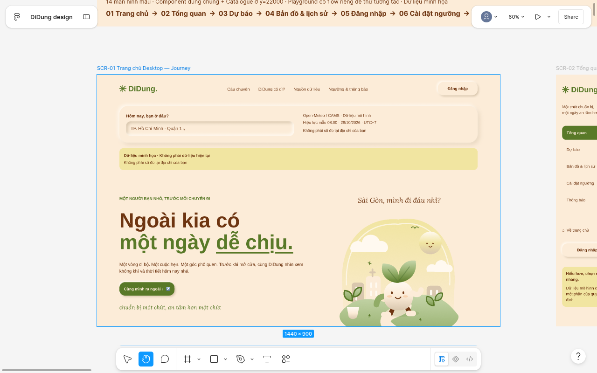
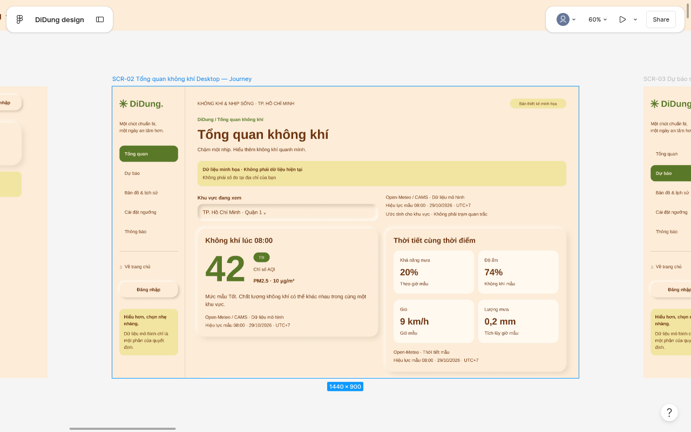
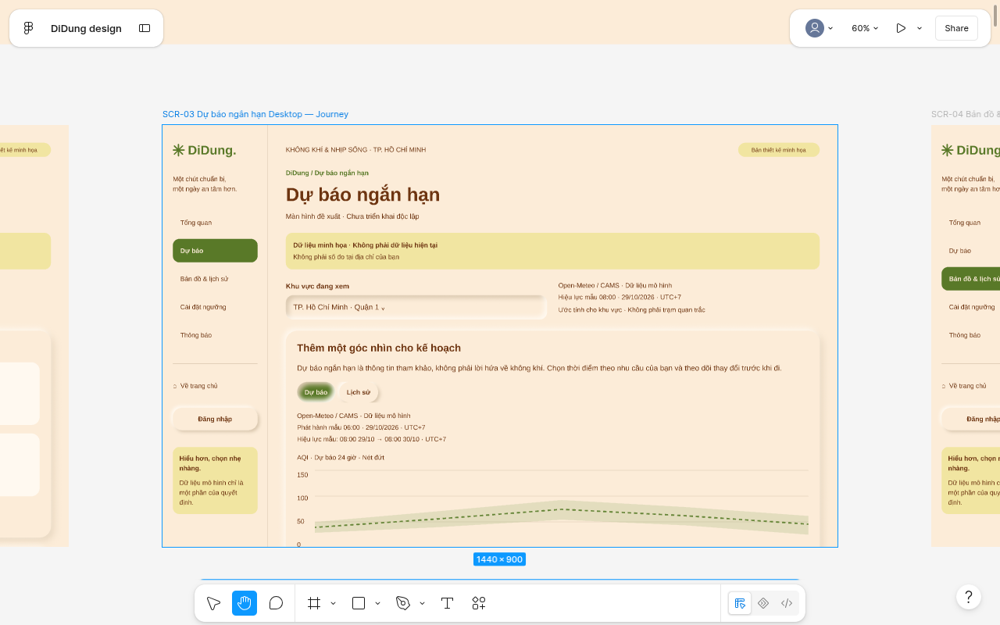
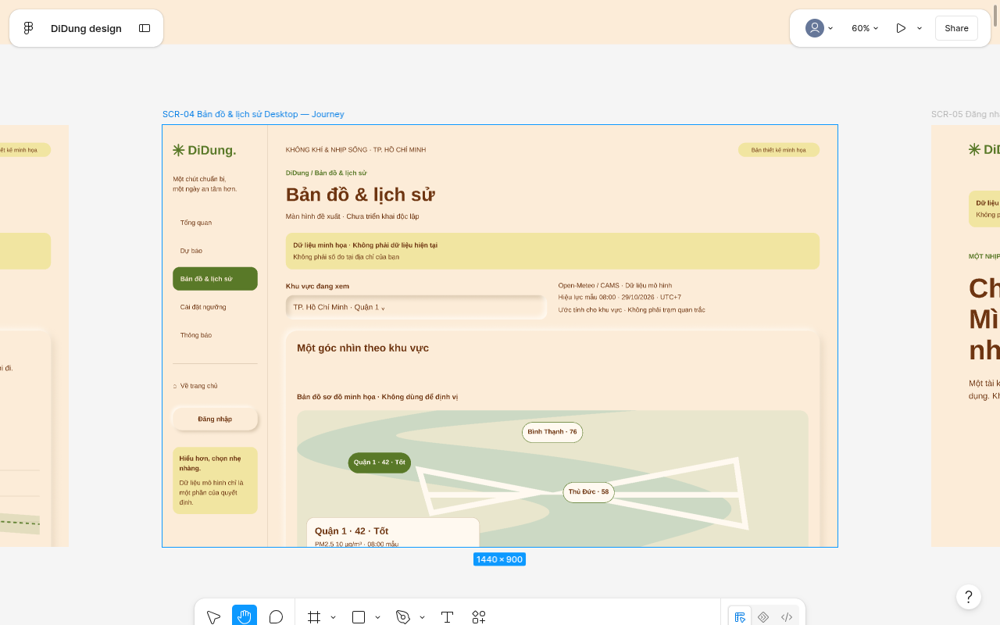
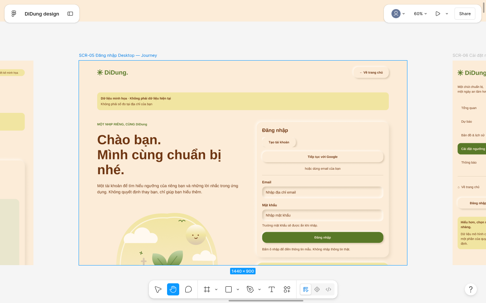
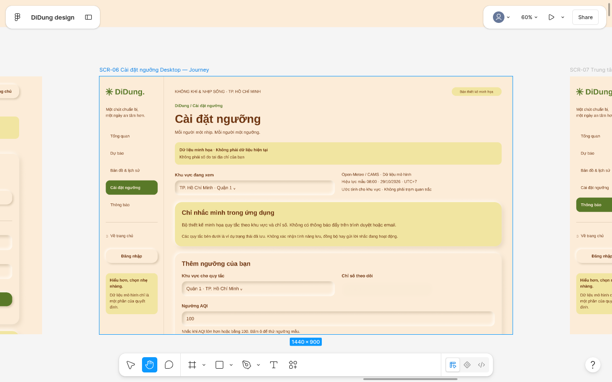
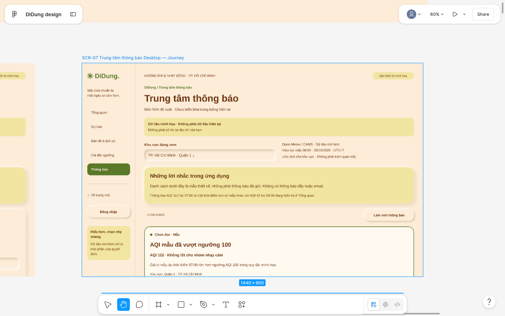

# Screen specifications

The six key specifications below retain PA2 screen IDs while describing the current route composition. SCR-02, SCR-03, SCR-04 and SCR-06 are regions of one protected `/app` page, not four standalone pages. UC identifiers come from [PA2 §6.3, pp. 14–15 and §7](../../../pa/PA2/10-PA2.pdf). UC-02 is titled **View PM2.5 forecast** in PA2; the current chart displays **US AQI**, so this is partial coverage, not full satisfaction of UC-02.

All designs use the cream/brown/olive palette and raised/inset surfaces in [design.md](../../../design.md). Design references show visual intent, not automatic approval of every implementation detail. No app UI was changed for this report.

## Design evidence register

| Ref | Existing design / image | Scope and limitation |
|---|---|---|
| D1 | [Frontend HTML preview](../../previews/2026-10-27-frontend-preview.html), sections `#auth`, `#app`, `#app-map`, `#app-thresholds` | Earlier editable mockup with sample data. Use its top buttons to select Auth or After sign-in; `#app` alone does not activate its hidden section. Its chart shows both series and its thresholds lack current CRUD controls. Its landing replacement link points to a file absent from this checkout. |
| D2 | [PA2 Figma design](https://www.figma.com/design/Ev67pGKl766yRwq4R7nu7G/DiDung-design?node-id=24-30405); repository [reference](../figma-design-for-frontend) | External design reference. Direct web-reader access failed in this run. Parent-supplied desktop Figma viewport captures F1–F7 are now available locally and were inspected in this run. They include editor chrome at fit zoom; original-resolution exports and immutable version IDs are still absent. Mobile frame descriptions below remain attributed to the PA2 review. |
| D3 | [Overview mobile frame 24:26057](https://www.figma.com/design/Ev67pGKl766yRwq4R7nu7G/DiDung-design?node-id=24-26057) | PA2 recorded a 390px overview with AQI/PM2.5 and a trend chart. See [PA2 review E01](../pa2/accessibility-review.md). |
| D4 | [Auth mobile frame 24:27908](https://www.figma.com/design/Ev67pGKl766yRwq4R7nu7G/DiDung-design?node-id=24-27908) | PA2 review E02 includes a forgot-password design control; current `LoginForm` does not implement that control. |
| D5 | [Threshold mobile frame 24:28252](https://www.figma.com/design/Ev67pGKl766yRwq4R7nu7G/DiDung-design?node-id=24-28252) | PA2 review E04 records labels, save/cancel and rule actions; full state coverage and comparator semantics were not verified. |
| D6 | [Admin role shell HTML](../../previews/2026-11-02-admin-role-shell.html) | Earlier editable admin/access-denied design reference, not evidence of management workflows. |
| B1 | [Public landing desktop](evidence/landing1440.png), [mobile](evidence/landing390.png) | Parent-supplied production captures; viewed in this run. Deployment commit unverified. The production selector differs from local source's disabled illustrative selector. |
| B2 | [Public air chapter](evidence/chapter-air1440.png), [trend chapter](evidence/chapter-trend1440.png) | Parent-supplied public-page images, viewed here. They display provider/time labels on production; they are not authenticated `/app` evidence and must not redefine the local illustrative implementation. |
| B3 | [Login desktop](evidence/login1440.png), [mobile](evidence/login390.png), [registration mode](evidence/signup1440.png) | Viewed here. Production `/login` has mode buttons and shared header/footer; local `/login` redirects to the split-layout `/auth` page. Useful visual references, not exact local-layout captures. |
| B4 | [Alert chapter](evidence/chapter-alert1440.png), [file named map1440](evidence/map1440.png) | Viewed here. Alert image shows a signed-out login prompt. The map-named image shows a **collapsed disclosure and weather content**, not an expanded map. Neither proves threshold CRUD, notification review or map interaction. |

F1–F7 are existing design captures, not a new mockup or implementation approval. The parent recorded their node URLs in [figma-evidence.md](figma-evidence.md) and [capture metadata](evidence/figma-captures.json). All seven were visually inspected in this run.

| Ref | Existing desktop design capture | Figma node |
|---|---|---|
| F1 | [SCR-01 landing](evidence/figma-scr01-desktop.png) | [24:32090](https://www.figma.com/design/Ev67pGKl766yRwq4R7nu7G/DiDung-design?node-id=24-32090) |
| F2 | [SCR-02 overview](evidence/figma-scr02-desktop.png) | [24:31664](https://www.figma.com/design/Ev67pGKl766yRwq4R7nu7G/DiDung-design?node-id=24-31664) |
| F3 | [SCR-03 forecast](evidence/figma-scr03-desktop.png) | [24:31378](https://www.figma.com/design/Ev67pGKl766yRwq4R7nu7G/DiDung-design?node-id=24-31378) |
| F4 | [SCR-04 map/history](evidence/figma-scr04-desktop.png) | [24:31108](https://www.figma.com/design/Ev67pGKl766yRwq4R7nu7G/DiDung-design?node-id=24-31108) |
| F5 | [SCR-05 auth](evidence/figma-scr05-desktop.png) | [24:30889](https://www.figma.com/design/Ev67pGKl766yRwq4R7nu7G/DiDung-design?node-id=24-30889) |
| F6 | [SCR-06 thresholds](evidence/figma-scr06-desktop.png) | [24:30726](https://www.figma.com/design/Ev67pGKl766yRwq4R7nu7G/DiDung-design?node-id=24-30726) |
| F7 | [SCR-07 notifications](evidence/figma-scr07-desktop.png) | [24:30513](https://www.figma.com/design/Ev67pGKl766yRwq4R7nu7G/DiDung-design?node-id=24-30513) |

Parent provenance and limited deployment observations are preserved in [browser-evidence.md](browser-evidence.md) and [JSON observations](evidence/browser-observations.json). No new browser execution was performed in this documentation run.

## SCR-01 — Public landing (UC-15)

**Route and access:** `/`, anonymous entry. Authenticated users redirect to `/app` or `/admin` according to role. Local landing data is explicitly illustrative and uses no live environmental API through its demo hooks. Design: F1, D2 and B1; earlier D1 landing is superseded according to its own banner.

| Control | Type / validation | Event handling |
|---|---|---|
| Brand, story/features/sources navigation and story rail | Links; section navigation managed by `LandingLink` | Move to the relevant landing section; sign-in links open `/auth`. |
| Illustrative location | Disabled select in local `LandingDemoToolbar` | No selection event or location persistence. Production B1's enabled-looking selector must not be claimed as local functionality. |
| Good / bad / missing example | Buttons in a labeled fieldset; `aria-pressed` state | `useAirDemo().setScenario` changes example values and explanatory text; missing displays a dash, not a good AQI. |
| History / forecast demonstration | Buttons | `useTrendDemo().setPeriod` switches illustrative series. No protected forecast request occurs here. |
| Sign in / threshold prompt | Link | Opens authentication; wording about notifications is a product description, not proof that a notification center is reachable. |

**States:** example scenarios include missing data. Timed example changes pause at initial reduced-motion preference. The account region uses `AccountGate`: checking-session feedback or signed-out prompt; server-side role redirect normally prevents an authenticated landing/profile screen. There is no live loading/error contract for the demo values. **Image gap:** B1 is a deployment reference, not a capture of this local revision; current illustrative states still need local/current-build captures.

**Source:** [page.tsx](../../../src/app/page.tsx), lines 14–33; [landing toolbar](../../../src/app/_components/demo/landing-toolbar.tsx); [demo air panel](../../../src/app/_components/demo/air-panel.tsx); [demo hooks](../../../src/hooks/use-landing-demo.ts); [navigation](../../../src/hooks/use-landing-navigation.ts).

## SCR-02 — Current AQI dashboard, weather and advice (UC-01, UC-09, UC-10)

**Route and access:** `/app`; signed-in users and admins. `AppPage` redirects anonymous users to `/auth?next=/app`. Design: F2, D1 `#app`, D3. B2's air chapter is supporting visual context only. **Runtime image gap:** F2 supplies the required existing design image; no authenticated current-dashboard screenshot is available. F2 depicts a separate overview page and illustrative values, whereas local source combines multiple regions.

| Control | Type / validation | Event handling |
|---|---|---|
| Current area | Labeled select populated by `/api/locations`; disabled until ready or when catalog empty | `LocationStore.select(id)` accepts only catalog IDs; stores selected ID in localStorage when available. Dependent hooks request data for that location. This is not UC-05 saved-location CRUD. |
| AQI and PM2.5 card | Read-only value, category, unit, model/source and valid time | `useAirQuality` projects the latest stored row with `valid_at <= now`. Invalid/missing numeric values display `—`; `airPresentation` handles missing before category classification. |
| Weather and advice cards | Read-only precipitation probability, humidity, wind, rain; summary/action/note | `useWeather` reads current weather and advisory endpoints independently; source/time and stale weather text are displayed. Advice shows model identity and a general-advice disclaimer. |
| Sidebar overview/map/thresholds | Anchor links | Move within `/app`; no separate forecast screen link is present in this sidebar. |
| Retry location / sign out | Button; sign-out disabled while pending | Catalog retry calls `load`; sign out calls the store, then replaces with `/` and refreshes. Failure preserves the page and displays an alert. |

**States:** initial auth check; catalog loading/error/empty; resource idle/loading/404-empty/401-unauthorized/error/ready. Current AQI and weather flag valid times older than three hours; this is a display rule, not proof of ingestion freshness. Individual cards expose error text but **do not render their resource `reload` buttons** in the active dashboard. Retry is explicit for the location catalog; page reload or a dependency change can re-request other data. Empty weather/advice and API failures must not be filled with demo data.

**Source:** [dashboard](../../../src/app/_components/experience/dashboard-experience.tsx), lines 11–44, 56–62, 83–99; [environment hooks](../../../src/hooks/use-environment.ts), lines 8–28; [presentation](../../../src/lib/api/presentation.ts), lines 4–25; [resource lifecycle](../../../src/hooks/use-api-resource.ts), lines 6–25.

## SCR-03 — Forecast region (partial UC-02; UC-09, UC-10)

**Route and access:** `TrendCard` within `/app`; legacy `/forecast` redirects to `/app`. Design: F3, D1 `#app` chart and D3. B2 trend image is a public deployment reference. **Runtime image gap:** F3 supplies an existing design image; no authenticated current forecast capture is available. F3 explicitly labels its separate page as proposed/not independently implemented and shows design-only issue-time information.

| Control | Type / validation | Event handling |
|---|---|---|
| History / forecast | Two buttons in a named group; `aria-pressed` | `setPeriod("history" \| "forecast")` changes the endpoint. Initial period is forecast. |
| Hourly chart | SVG with title and description, hour labels and caption | `chartPresentation` orders valid times, excludes invalid numeric points, breaks paths across missing values and draws forecast dashed/history solid. |
| Selected area | Shared SCR-02 select | Changes the location ID used by the current series request. |

**Data and validation:** UI supplies no date picker, horizon input, metric selector or forecast issue-time field. Forecast API defaults to 24 hours and caps its `hours` parameter at 72; the UI sends no `hours` override. It reads future rows already in `air_quality_model`, not the separate `forecasts` table. PM2.5 is returned by the endpoint but **is not drawn** in `TrendCard`. Do not claim PA2's PM2.5/1–6-hour/issue-time requirements are all implemented.

**States:** loading, unauthorized, error, HTTP 404-empty via common resource helper; a successful response with no usable chart points shows explicit no-points text. The chart description gives series type, count and timezone, not a complete textual list of the hourly values. No forecast-specific retry control is rendered in the active dashboard.

**Source:** [TrendCard](../../../src/app/_components/experience/dashboard-experience.tsx), lines 46–54; [useAirTrend](../../../src/hooks/use-environment.ts), lines 30–34; [forecast route](../../../src/app/api/air-quality/forecast/route.ts); [chart projection](../../../src/lib/api/presentation.ts), line 26.

## SCR-04 — Map and history (UC-03, UC-09, UC-10)

**Route and access:** `/app#app-map`, with history in the same page's trend region; legacy `/map` redirects to the map anchor. Design: F4, D1 `#app-map` placeholder and trend chart. **Runtime image gap:** F4 supplies the existing map/history design image, explicitly labeled illustrative/proposed. `map1440.png` is collapsed public content; an expanded current authenticated Mapbox screenshot remains unavailable.

| Control | Type / validation | Event handling |
|---|---|---|
| Map navigation | Mapbox `NavigationControl`; conditional on public token configuration | Map creation uses the map hook; initialization/load errors are converted to visible text. Actual keyboard behavior remains a browser follow-up. |
| Map markers / popup action | Marker plus popup text and “Choose area” button | Finite coordinates are required for a marker. Popup contains location, AQI category/value, PM2.5, valid time and stale flag; action calls `select(location_id)`. Selected location popup opens. |
| Area list | Shared labeled select at dashboard top | Remains available without Mapbox. It selects a location but does not provide a full equivalent list of all map readings. |
| History button | Shared trend control | Requests the last 24 hours by default. There is no map time slider or UI date-range input; history is not an animated historical map. |

**States:** snapshot loading/error/unauthorized; absent token displays an explanation and directs users to the selector above. Map initialization error also displays text, although one error string says the list is “below” while the actual selector is above. Snapshot API includes active locations even when no reading exists within its three-hour window; missing values remain null and are projected to missing text. A ready empty snapshot does not have a separate dedicated empty-map message in `MapCard`.

**Source:** [MapCard](../../../src/app/_components/experience/dashboard-experience.tsx), lines 64–72; [map hook](../../../src/hooks/use-map-canvas.ts), lines 6–51; [snapshot route](../../../src/app/api/map/snapshot/route.ts); [history route](../../../src/app/api/air-quality/history/route.ts).

## SCR-05 — Sign in and registration (UC-04)

**Route and access:** `/auth`; `/login` is an alias redirect. Existing authenticated users go to their role default; successful completion may honor a safe authorized `next` path. Design: F5, D1 `#auth`, D4 and B3. B3 shows production mode buttons rather than the local text switch and split layout. **Runtime image gap:** F5 supplies an existing design image; no matching local/current-build auth screenshot is supplied. The Figma screen is illustrative and does not prove actual sign-in.

| Control | Type / validation | Event handling |
|---|---|---|
| Email | Required `type=email`, explicit label, `autocomplete=email` | Native validation precedes submit. Hook trims email before sending. |
| Password | Required `type=password`; signup minimum six characters; current/new-password autocomplete by mode | Stored only in hook state for this form; switch mode clears password and feedback. No confirm-password field is implemented. |
| Sign-in / create-account submit | Submit button; disabled for pending/auth loading | Calls password sign-in or signup. If signup returns no session, password clears and confirmation-email instructions appear; with a session, completion redirects. Registration is implemented, not merely a proposal. |
| Continue with Google | Button; disabled while pending/loading | Starts provider flow with callback and optional `next`; callback exchanges code for session. Provider/callback errors return a retryable sign-in message. |
| Switch mode / return to introduction | Button / link | Switches form mode locally or returns to `/`. No forgot-password workflow is implemented despite the PA2 design reference. |

**States and navigation:** pending processing, provider/credentials error (`role=alert`), email-confirmation instructions (`role=status`), callback failure and completion. `safeAuthRequestPath` rejects external/protocol-relative/unsafe paths and auth loops; `authPathForRole` prevents ordinary users returning to `/admin`. Only `app_metadata.app_role === "admin"` grants admin; registration does not let a user choose that role. Service-side password/email policy can return further errors; six-character HTML validation alone does not prove acceptance by Supabase.

**Source:** [LoginForm](../../../src/app/_components/live/login-form.tsx), lines 3–18; [useAuthForm](../../../src/hooks/use-auth-form.ts), lines 5–40; [auth store](../../../src/stores/auth-store.ts), lines 36–69; [auth navigation](../../../src/lib/auth-navigation.ts); [callback](../../../src/app/auth/callback/route.ts).

## SCR-06 — Personal thresholds and area selection (UC-06; UC-05 gap)

**Route and access:** `/app#app-thresholds`; owner-authenticated API operations. `/notifications` currently redirects here. Design: F6, D1 `#app-thresholds`, D5. B4 alert image illustrates only the signed-out entry. **Runtime image gap:** F6 supplies an existing threshold design image; no authenticated current create/edit/error capture is supplied. No saved-location management screen is implemented.

| Control | Type / validation | Event handling |
|---|---|---|
| Metric | Labeled select: `aqi` or `pm25`; disabled while editing/pending | `setMetric`; existing rule metric and location cannot be changed by edit. |
| Threshold | Required numeric input; AQI min 1/step 1, PM2.5 min 0.1/step 0.1 | Hook rejects blank, nonfinite, nonpositive, fractional AQI and PM2.5 off the 0.1 grid. These client rules are stricter than the route's type checks. |
| Add / save changes | Submit button; disabled if no location for creation or mutation pending | `save` POSTs location/metric/value for creation or PATCHes only value when editing. Success resets defaults and re-reads via mutation revision. |
| Edit / cancel | Buttons | Edit loads row values; cancel resets metric AQI/value 100 and clears validation. Active dashboard Edit and Cancel are not disabled while a mutation is pending, unlike several other controls. Do not claim a fully locked form. |
| Enable / disable / delete | Row buttons; disabled while mutation pending | PATCH active flag or DELETE the rule. No delete-confirmation dialog is implemented. Text states show enabled/disabled. |
| Area selector | Shared SCR-02 select | Determines location for a new rule; selection is local preference. No add/remove/list account-owned saved-location operations exist. |

**Validation boundary:** collection POST requires a location, allowed metric and numeric `threshold_value`; item PATCH accepts numeric value or boolean active flag, rejects an empty supported update, and owner-filters the target. It does not enforce all client positivity/precision rules. Database FK/RLS constraints may reject requests. This report records the mismatch rather than claiming server parity or changing validation.

**States:** list loading/empty/error/unauthorized; mutation pending, success and failure; local field validation; selected-area absence. Error/success messages use alert/status roles but are not explicitly associated with the input by `aria-describedby`/`aria-invalid`. Account identity/generation guards mutation completion. Automatic threshold evaluation is UC-11, not executed by saving the form; current evaluator uses `>=`, eligible recent data and daily deduplication.

**Source:** [ThresholdCard](../../../src/app/_components/experience/dashboard-experience.tsx), lines 74–80; [useThresholds](../../../src/hooks/use-account.ts), lines 41–64; [collection route](../../../src/app/api/me/thresholds/route.ts); [item route](../../../src/app/api/me/thresholds/[id]/route.ts); [evaluator](../../../src/app/api/jobs/evaluate-alerts/route.ts).

## Additional screens, states and design references

| Screen / artifact | Current status | Existing design reference and image gap |
|---|---|---|
| SCR-07 notification center, UC-07 | `useNotifications`, GET/mark-read APIs and `LiveAlertPanel` exist; no active route renders the center. `/notifications` redirects to thresholds. Do not present notification reading as reachable. | F7 is the existing design image at node 24:30513; it explicitly says proposed/not implemented in the current flow. B4 is only an entry prompt. No runtime center image can be claimed from either. |
| Saved-location management, UC-05 | `user_locations` table exists; account-owned CRUD screen/API not found. Local catalog selection is not its implementation. | General D2 and PA2 UC-05 requirement only; no distinct saved-location frame/image verified. Record design-image gap, not an invented screen. |
| Admin shell | `/admin`, admin-only placeholder; “View user site” and sign-out work by source; management labels are “Coming soon.” | D6 editable HTML; no current runtime image supplied. No claim that UC-14 monitoring is implemented. |
| Forbidden | `/forbidden`, ordinary authenticated users; admins redirect to `/admin`, anonymous users to `/auth`. Return-to-app/sign-out controls. | D6 access-denied view (`show('forbidden')` in its preview script); no current runtime image supplied. |
| Profile/account region | `ProfilePanel` on public landing shows an account gate. Authenticated entry normally redirects; `/profile` redirects to `/app`, whose sidebar displays identity and sign-out, not a profile edit form. | D2 general reference; no distinct profile image verified. Existing dormant edit form is not evidence of a reachable profile screen. |
| Callback, legacy redirects and resource feedback | Navigation/state mechanisms, not independent product screens | D1/D4 for destination layout; no dedicated callback/loading/error design exports locally. Required state screenshots remain a follow-up. |

All six key screens and the additional notification design now have local design captures. Original-resolution exports, immutable design versions, saved-location/profile-specific designs and current authenticated runtime images remain evidence gaps for final document assembly. They do not require implementation, new mockup approval or invented screenshots in this documentation-only task.
